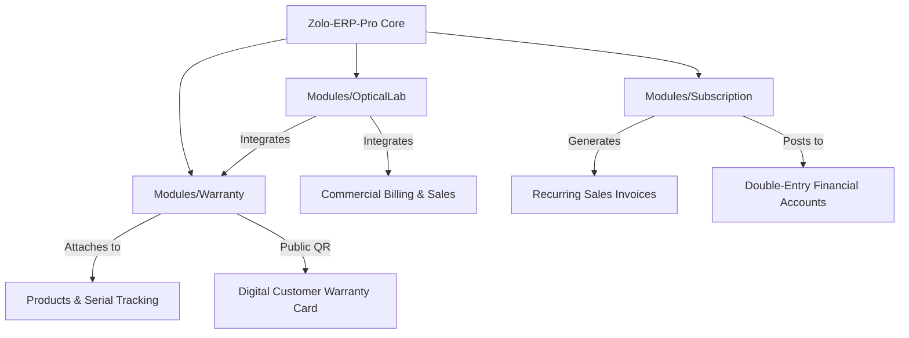
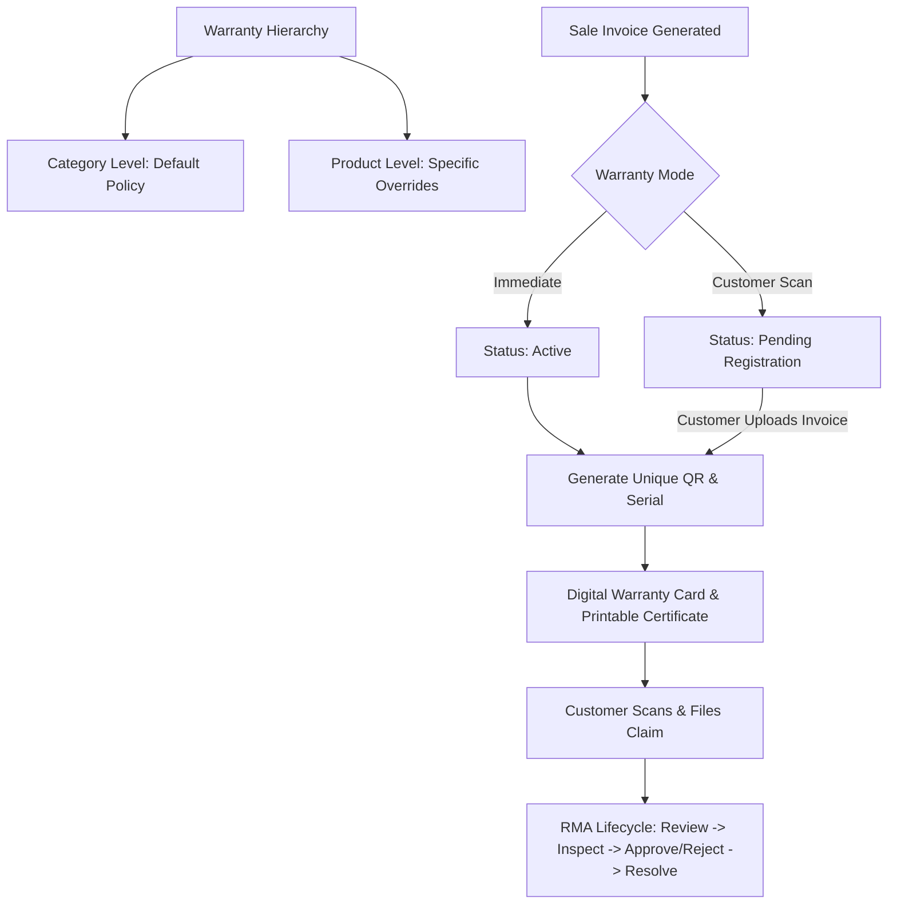
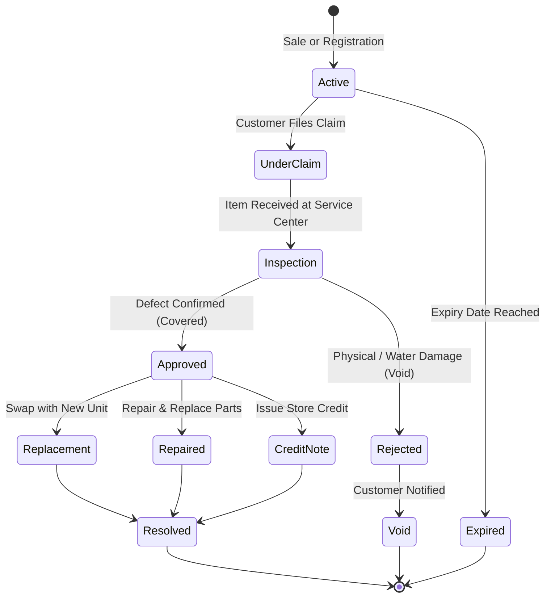
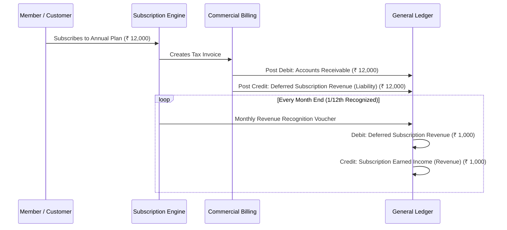

# Zolo-ERP-Pro Modular Addons Architecture Specification

> **Document Version:** 1.0.0  
> **Target Platform:** Zolo-ERP-Pro Enterprise  
> **Architecture Pattern:** Pluggable Modules (`nwidart/laravel-modules` / `Modules/` directory)  
> **Status:** Architectural Blueprint & Implementation Specification  

---

## Executive Summary

This document specifies the architecture, data models, workflows, and UI specifications for three high-value modular Addons designed to seamlessly plug into **Zolo-ERP-Pro**:

1. **Optical & Lens Manufacturing Profile (`Modules/OpticalLab`)** — Complete lens surfacing, coating, fitting, and optical distribution management with RX prescription tracking, thermal lab dockets, order extras, and consolidated optician billing.
2. **Universal Warranty & Serial Verification Engine (`Modules/Warranty`)** — An enterprise cross-industry warranty lifecycle management system featuring category/product-level configuration, multiple warranty models (time, usage, tiered, extended), dynamic QR codes, digital warranty cards, and RMA claims workflows.
3. **Recurring Subscription & Membership Management (`Modules/Subscription`)** — Comprehensive membership management tailored for Gyms, Spas, Salons, Wellness Clubs, Co-working spaces, and AMC contracts with recurring auto-invoicing, attendance kiosk check-in, freeze policies, and deferred revenue accounting.



---

## SECTION 1: Addon 1 — Optical & Lens Manufacturing Profile (`Modules/OpticalLab`)

### 1.1 Industry Background & Domain Workflow
In the optical industry, lens surfacing and fitting laboratories operate differently from standard manufacturing:
- Orders are placed by **Opticians / Retailer Stores** (B2B), but every pair of lenses is custom-manufactured to an individual **Patient's Eye Prescription** (B2C data).
- Multiple daily lens jobs arrive from the same optician; invoicing occurs via daily or monthly consolidated statements rather than single invoice dispatch.
- Lenses undergo custom surfacing (grinding RX curve), coating chambers (Hard Coat, Anti-glare, Blue Cut, Drive-X, Tinting), and edging/fitting into optical frames.

### 1.2 Data Architecture & Schema

#### A. Order Prescription Parameters (`optical_prescriptions`)
Linked to each sales bill item line (`product_sales` / `commercial_document_items`):

| Column | Type | Description |
| :--- | :--- | :--- |
| `id` | BIGINT (PK) | Unique Identifier |
| `document_item_id` | BIGINT (FK) | Reference to line item |
| `eye` | ENUM('OD', 'OS', 'BOTH') | Right Eye (OD), Left Eye (OS), or Pair |
| `sph` | DECIMAL(5,2) | Sphere power (-20.00 to +20.00 in 0.25 steps) |
| `cyl` | DECIMAL(5,2) | Cylinder power (-10.00 to +10.00 in 0.25 steps) |
| `axis` | SMALLINT | Cylinder Axis (1° to 180°) |
| `addition` | DECIMAL(4,2) | Reading Addition (+0.50 to +4.00) |
| `base_prism` | VARCHAR(20) | Prism & Base direction (Up, Down, In, Out) |
| `pd` | DECIMAL(4,1) | Pupillary Distance (e.g., 31.5 mm per eye or 63.0 mm total) |
| `fitting_height` | DECIMAL(4,1) | Corridor / Segment fitting height (mm) |

#### B. Lens Master Attributes (`optical_lens_attributes`)
Extends `products` table for optical items:

| Field | Options / Type |
| :--- | :--- |
| **Lens Type** | Single Vision (SV), Bifocal (Kryptok, D-Segment), Progressive (Standard, HD Digital), Toric |
| **Diameter (`dia`)** | 60mm, 65mm, 70mm, 75mm, 80mm |
| **Refractive Index** | 1.50 (Standard CR39), 1.56 (Mid-Index), 1.60 (Thin), 1.67 (Ultra-Thin), 1.74 (Super-Thin) |
| **Material** | CR-39, Polycarbonate, Trivex, High-Index Organic, Mineral Glass |
| **Coatings** | Uncoated (UC), Hard Coat (HC), Anti-Reflective HMC (Emerald Green / Sapphire Blue), Blue Cut Digital, Drive-X Night Filter, Photochromic (Grey / Brown), Polarized |

#### C. Order Extras & Lab Add-on Services (`optical_order_extras`)
Tracks value-added processing charges attached to a job:
- **Service Types:**
  1. *Frame Fitting / Mounting:* Full Rim, Semi-Rimless (Groove/Nylon), Rimless (Drill mount).
  2. *Custom Tinting:* Full Solid Tint, Gradient Tint, Ray-Ban G15 Green, Sunglass Grey/Brown.
  3. *Special Processing:* Prism surfacing, Slab-off, High-minus edge bevel thinning.
- Each extra supports fixed rate or custom fee, automatically added to the job cost breakdown.

#### D. End-User Patient Records (`optical_patients`)
Captures patient data without cluttering the primary B2B customer master:
- `patient_name`, `patient_phone`, `patient_email`, `patient_address`
- Prescribing Optometrist / Ophthalmologist name & clinic address
- Used for digital warranty generation and optical service tracking.

---

### 1.3 Optical Lab Operational Interfaces

#### 1. Lab Surfacing & Fitting Docket (`lab_receipt`)
Thermal (80mm) or A5 docket dispatched with lens trays to optical lab technicians:
- **Header:** Job Order #, Date/Time, B2B Optician Name, Patient Name, Required By Date.
- **Rx Matrix Table:** Clean grid presenting OD/OS SPH, CYL, AXIS, ADD, PD, Segment Height.
- **Physical Lens Spec:** Blank Diameter, Material, Index, Coating Chamber Batch.
- **Fitting Instructions:** Frame Type (Acetate/Metal/Rimless), Tracer shape ID, Tint sample code.
- **Lab Technician QR Code:** Scanning advances job state (`Ordered` → `Surfacing` → `Coating` → `Edging/QC` → `Ready for Dispatch`).

#### 2. Lens Return & Rejection Verification
When an optician returns lenses due to power mismatch or fitting errors:
- Returns table records `actual_tested_sph`, `actual_tested_cyl`, `actual_tested_axis`.
- Lensometer inspection report: validates if the returned lens is outside standard ISO/ANSI tolerances (lab defect = free remake) or matches order specs (optician mistake).

#### 3. Consolidated B2B Billing Subsystem (`CustomerBill` / `CustomerBillMonthly`)
- High-volume optical labs bill opticians once daily or once monthly.
- Aggregates all daily delivered jobs, subtracts verified returns and credit adjustments (`total_less`).
- Formats tax summary into GST outward supply reports (CGST, SGST, IGST) with auto-generated monthly statements.

---

## SECTION 2: Addon 2 — Universal Warranty & Serial Verification Engine (`Modules/Warranty`)

### 2.1 Scope & Cross-Industry Applicability
The Warranty Module is architected as an **independent, universal system** capable of managing warranties across diverse product verticals:
- **Optical & Eyewear:** Anti-reflective coating peeling warranty, progressive lens non-adaptation guarantees.
- **Electronics & Appliances:** Smartphones, Laptops, LED TVs (IMEI / Serial tracking, panel vs board warranties).
- **Industrial & Machinery:** Motors, Compressors, Tools (Hour-meter / Cycle-based warranties).
- **Automotive & Batteries:** Batteries, Tyres (Pro-rata warranty, replacement vs depreciation).
- **Watches, Jewellery & Luxury:** Authenticity certification, movement warranty.



---

### 2.2 Hierarchical Configuration Architecture

#### Level 1: Category-Level Default Configuration
Located in `categories` / `product_categories`:
- `has_warranty`: Boolean toggle (indicates if products in this category carry warranty).
- `default_warranty_months`: Standard duration (e.g. 12 months).
- `default_warranty_type`: Time-based, Usage-based, or Lifetime.
- `default_coverage_scope`: Comprehensive (parts + labor), Parts Only, or Replacement Guarantee.
- `requires_serial_number`: Boolean (enforces entering serial/IMEI at time of sale).

#### Level 2: Product-Level Granular Configuration
Overrides category defaults on a per-product basis (`products` table):
- `warranty_override`: Boolean.
- `warranty_duration_value` & `warranty_duration_unit`: (e.g., 24 Months, 3 Years, 500 Hours).
- `warranty_terms_conditions`: Rich-text field specifying inclusions and exclusions.
- `warranty_card_template`: Selection of card layout (Digital, Luxury A4, Compact Thermal, PVC Card).
- `grace_period_days`: Window allowed for late claims or customer registration (e.g., 30 days).

---

### 2.3 The 8 Universal Dimensions of Warranty Configuration

| # | Dimension | Configuration Modes & Explanations |
| :---: | :--- | :--- |
| **1** | **Duration Mode** | - **Fixed Calendar Time:** 6 Months, 1 Year, 2 Years, 3 Years, 5 Years.<br>- **Lifetime Warranty:** Active for the operational life of the product.<br>- **Fixed Expiry Date:** All items in a campaign expire on a specific date (e.g., clearance batches). |
| **2** | **Activation Trigger** | - **On Billing (POS/Invoice):** Warranty starts immediately on the invoice date.<br>- **On Delivery / Installation:** Starts when technician marks installation completed.<br>- **On Customer Self-Registration:** Starts when customer scans QR, enters serial #, and uploads proof of purchase. |
| **3** | **Tracking Identity** | - **Unique Serial Number / IMEI:** Each unit has its own distinct identity (`SN-2026-XXXX`).<br>- **Batch / Lot Number:** Group warranty based on manufacturing production batch.<br>- **Invoice & Customer Phone:** Non-serialized items validated using original invoice number and mobile OTP. |
| **4** | **Coverage Scope** | - **Comprehensive:** 100% parts, labor, and transport covered.<br>- **Parts Only:** Free replacement parts; service/labor charged to customer.<br>- **Replacement Only:** Zero repair; defective unit swapped with fresh unit.<br>- **Pro-Rata / Depreciation:** Customer pays a % based on months used (common in batteries/tyres). |
| **5** | **Customer Registration Flow** | - **Pre-registered by Merchant:** Full customer name, photo, address recorded at checkout.<br>- **Self-Serve Online Registration:** QR on box routes to `/warranty/register`, customer uploads receipt & selfie. |
| **6** | **Transferability** | - **Non-Transferable:** Valid strictly for the original registered customer.<br>- **Transferable:** Follows the serial number/device regardless of change in ownership. |
| **7** | **Usage / Meter-Based** | - Dual condition: `12 Months` OR `10,000 Operating Hours` (whichever occurs first). |
| **8** | **Extended Warranty** | - Sellable Addon SKU: Extends standard warranty by +12 or +24 months, purchased at POS or within the active warranty window. |

---

### 2.4 Warranty Card Generation Formats

#### Format A: Responsive Digital Customer Warranty Card (Web)
Accessible at `https://your-domain.com/warranty/verify?serial={SERIAL_NUMBER}`:
- **Visual Design:** Premium gradient glassmorphism card styled in brand colors.
- **Live Status Badge:** `ACTIVE` (Green pulse), `EXPIRING SOON` (Amber), `EXPIRED` (Red), `CLAIM IN PROCESS` (Blue).
- **Core Card Data:** Serial Number, Product Name, SKU, Purchase Date, Warranty Valid Until, Customer Name & Photo.
- **Prescription / Technical Specs Section:** Dynamically rendered if optical or electronic specs exist.
- **One-Click Actions:** Download Official PDF Certificate, File a Claim, Contact Authorized Service Center.

#### Format B: Official Printable A4 Warranty Certificate
- High-resolution SVG/PDF document designed with formal security borders, guilloche patterns, watermark, and QR stamp.
- Suitable for high-ticket appliances, industrial machinery, and luxury jewellery/optics.

#### Format C: Thermal POS Box Insert Slip (80mm)
- Compact printout generated at the billing counter alongside the receipt.
- Contains the unique serial number, basic terms, and large QR code ready to be dropped into the product packaging.

#### Format D: PVC / Smart Card Format (CR80 Standard)
- Standard 85.6 mm × 53.98 mm format for printing on plastic card embossers/printers for VIP customers or prescription eyewear cards.

---

### 2.5 Warranty Claims & RMA Lifecycle State Machine



---

## SECTION 3: Addon 3 — Recurring Subscription & Membership Module (`Modules/Subscription`)

### 3.1 Industry Use Cases
Tailored for subscription-based and membership-driven enterprises:
- **Fitness Centers & Gyms:** Monthly/Annual gym access, Personal Trainer (PT) packs, locker rentals.
- **Spas, Salons & Wellness Clinics:** Monthly massage clubs, annual beauty packages, credit redemption.
- **Co-working Spaces & Clubs:** Desk passes, monthly conference room credits.
- **Annual Maintenance Contracts (AMC):** IT hardware support, HVAC servicing, machinery maintenance contracts.

---

### 3.2 Data Architecture & Schema

#### A. Subscription Plans (`subscription_plans`)

| Column | Type | Description |
| :--- | :--- | :--- |
| `id` | BIGINT (PK) | Plan Identifier |
| `name` | VARCHAR(150) | Plan Title (e.g., Gold Annual Fitness, Spa Indulgence Club) |
| `billing_interval` | ENUM | `daily`, `weekly`, `monthly`, `quarterly`, `semi_annual`, `annual` |
| `interval_count` | SMALLINT | Multiplier (e.g., every 3 months) |
| `price` | DECIMAL(15,2) | Recurring subscription charge |
| `admission_fee` | DECIMAL(15,2) | One-time sign-up / onboarding fee |
| `tax_id` | INT (FK) | Applicable GST/VAT rate |
| `plan_type` | ENUM | `unlimited_time`, `session_credits`, `hybrid` |
| `total_credits` | INT | Initial credits loaded for session-based plans (e.g., 20 sessions) |
| `allow_freeze` | BOOLEAN | Allows member to pause membership |
| `max_freeze_days` | INT | Maximum cumulative pause days allowed per year (e.g., 30 days) |
| `access_hours` | ENUM | `all_day`, `peak_only`, `off_peak` |

#### B. Member Subscriptions (`member_subscriptions`)

| Column | Type | Description |
| :--- | :--- | :--- |
| `id` | BIGINT (PK) | Subscription Record ID |
| `member_id` | BIGINT (FK) | Reference to `customers` table |
| `plan_id` | BIGINT (FK) | Reference to `subscription_plans` |
| `subscription_no` | VARCHAR(50) | Unique Code (e.g., `SUB-2026-0042`) |
| `start_date` | DATE | Membership commencement date |
| `end_date` | DATE | Current cycle expiry date |
| `next_billing_date` | DATE | Date when next invoice generates |
| `status` | ENUM | `active`, `frozen`, `past_due`, `cancelled`, `expired` |
| `remaining_credits` | INT | Balance of session credits |
| `auto_renew` | BOOLEAN | Automatic renewal flag |
| `digital_pass_token` | VARCHAR(100) | Token for QR attendance check-in |

#### C. Membership Freeze Logs (`subscription_freeze_logs`)
- Tracks when a member pauses their membership (travel, injury, medical leave).
- Columns: `freeze_start_date`, `freeze_end_date`, `actual_resume_date`, `days_frozen`, `reason`.
- **Automatic Extension:** When membership is un-frozen, the system dynamically pushes `end_date` and `next_billing_date` forward by the exact number of frozen days.

#### D. Check-in & Attendance Kiosk (`subscription_checkins`)
- Records daily member access: `checkin_time`, `checkout_time`, `kiosk_terminal_id`, `verified_by`.
- For credit-based plans, checking in automatically deducts 1 credit and displays remaining balance on the reception kiosk screen.

---

### 3.3 Accounting & Billing Integration (Double-Entry ERP Compliance)



1. **Deferred Revenue Recognition (Accrual Accounting):**
   - When an upfront annual membership of ₹ 12,000 is collected, the entire amount cannot be booked as immediate revenue under standard accounting principles (Ind AS 115 / IFRS 15).
   - Zolo-ERP-Pro posts the credit to **Deferred Subscription Income (Current Liability)**.
   - On the final day of each calendar month, an automated system cron posts a Journal Voucher moving ₹ 1,000 from Deferred Income to **Earned Subscription Revenue (P&L)**.
2. **Recurring Invoice Automation:**
   - Automated schedulers generate draft or posted recurring invoices 3 days before cycle end.
   - Sends automated payment link (Razorpay / UPI / Stripe) via WhatsApp and Email.

---

## SECTION 4: Implementation Roadmap & File Layout

### 4.1 Modular Directory Structure

```
zolo-erp-pro/
├── Modules/
│   ├── OpticalLab/
│   │   ├── Config/
│   │   ├── Database/
│   │   │   └── Migrations/
│   │   │       ├── 2026_11_01_create_optical_prescriptions_table.php
│   │   │       ├── 2026_11_01_create_optical_order_extras_table.php
│   │   │       └── 2026_11_01_create_customer_bills_table.php
│   │   ├── Http/Controllers/
│   │   │   ├── OpticalOrderController.php
│   │   │   ├── LabReceiptController.php
│   │   │   └── ConsolidatedBillingController.php
│   │   ├── Models/
│   │   │   ├── OpticalPrescription.php
│   │   │   ├── OpticalOrderExtra.php
│   │   │   └── CustomerBillMonthly.php
│   │   └── Resources/views/
│   │       ├── lab_receipt.blade.php
│   │       └── consolidated_billing.blade.php
│   │
│   ├── Warranty/
│   │   ├── Database/
│   │   │   └── Migrations/
│   │   │       ├── 2026_11_01_create_warranties_table.php
│   │   │       ├── 2026_11_01_create_warranty_claims_table.php
│   │   │       └── 2026_11_01_add_warranty_config_to_products_table.php
│   │   ├── Http/Controllers/
│   │   │   ├── WarrantyAdminController.php
│   │   │   ├── WarrantyClaimController.php
│   │   │   └── PublicWarrantyController.php
│   │   ├── Models/
│   │   │   ├── Warranty.php
│   │   │   └── WarrantyClaim.php
│   │   ├── Services/
│   │   │   ├── WarrantyQrService.php
│   │   │   └── WarrantyCardRenderer.php
│   │   └── Resources/views/
│   │       ├── public_card.blade.php
│   │       ├── certificate_a4.blade.php
│   │       └── thermal_slip.blade.php
│   │
│   └── Subscription/
│       ├── Database/
│       │   └── Migrations/
│       │       ├── 2026_11_01_create_subscription_plans_table.php
│       │       ├── 2026_11_01_create_member_subscriptions_table.php
│       │       └── 2026_11_01_create_subscription_checkins_table.php
│       ├── Http/Controllers/
│       │   ├── PlanController.php
│       │   ├── MemberSubscriptionController.php
│       │   └── AttendanceKioskController.php
│       ├── Services/
│       │   ├── SubscriptionBillingService.php
│       │   └── DeferredRevenueService.php
│       └── Resources/views/
│           ├── member_pass.blade.php
│           └── kiosk.blade.php
```

---

## SECTION 5: Verification & Safety Checklist

- [x] **No Core File Regression:** Modules register via native Service Providers; core Zolo-ERP-Pro commercial desks remain untouched.
- [x] **Multi-Tenant Scoping:** All module tables include `company_id` and `branch_id` foreign keys to ensure enterprise isolation.
- [x] **Indian GST Ready:** All consolidated bills, order extras, and subscription invoices integrate with Zolo-ERP-Pro's native GST/HSN tax calculation engine.
- [x] **Double-Entry Balance Enforced:** Subscription deferred revenue and warranty replacement adjustments strictly balance debits and credits in the General Ledger.

