# Sample GST Sales Bill: Setup to Printed Invoice

Done on 12-10-2026 in the dev app (`http://localhost:8080`, WSL MariaDB `zoloerp`), logged in as `admin`.
I used the normal screens through a real Chrome browser (Playwright), except for step 1, which has no screen yet.
Screenshots are in this folder, and the final invoice is in [tax-invoice-MJ-00001.pdf](tax-invoice-MJ-00001.pdf).

**Result:** sales bill **MJ-00001** for ₹15,104.00 (taxable 12,800 + CGST 1,152 + SGST 1,152) is posted, has its journal entry, and prints as the A4 tax invoice.

All names, GSTINs and bank details below are made up. Each GSTIN has a valid check digit but does not belong to a real business.

---

## What the dev database was missing

| Needed to post a GST bill | State before | Fixed in |
|---|---|---|
| Accounts for receivables, sales, stock, cost of goods sold and cash | Only the 9 GST and round-off ledgers | Step 1 |
| Company GST registration (GSTIN) | None, so GST billing was off | Step 2 |
| GST rate and HSN on the products sold | Not set | Step 4 |
| Customer GSTIN and state | Blank | Step 5 |
| Stock of the items sold | 0 | Step 7 |

---

## Step 1: Install the standard chart of accounts (tinker, no screen)

New companies created from the company picker get the standard chart from `CompanyDirectoryService::installChart()`.
Company 1 is older, so it never got one, and the app has no button to install it later.
I ran the same logic for company 1 in `php artisan tinker`:

- inserted the 32 accounts from `ChartOfAccountsSeeder::accounts()` (skipping any code already present; there were none)
- ran `SemanticAccountResolver::seedCompany(1)` to link posting roles to accounts

Roles now linked: `ar` 1100, `ap` 2010, `cash` 1010, `bank` 1020, `inventory` 1200, `sales` 4010, `cogs` 5010, `tax_output` 2020 and `discounts` 4020, plus the GST and round-off ledgers.
These roles are still unlinked: `production_costs`, `tax_input`, `freight`, `goods_in_transit`, `expense`, `sales_returns`, `purchase_returns`, `damage` and `variance`. A normal sale does not use them, but returns and freight will need them later (Accounting › Semantic account mappings).

## Step 2: Company GST registration

**Settings › GST › Registration**

| Field | Value |
|---|---|
| GSTIN | `33ABCDE1234F1Z7` (Tamil Nadu) |
| Legal name | Zolo Computers Private Limited |
| Trade name | Zolo Computers |
| Type | Regular |
| Effective from | 01-04-2026 |
| Address | No. 12, Anna Salai, Teynampet, Chennai, Tamil Nadu 600018 |

Saving it also set the company's country to `IN` and its state to `33`. GST billing turned on for the branch.

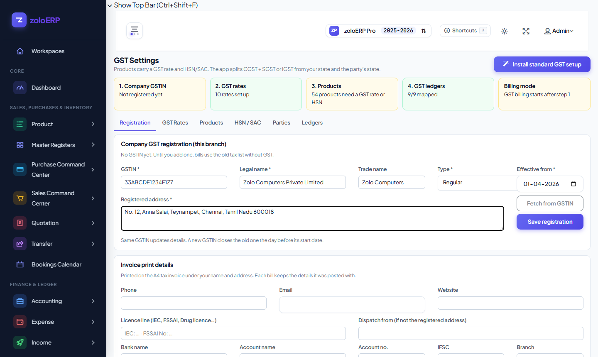

## Step 3: Invoice print details

**Settings › GST › Registration › Invoice print details**: phone, email, bank (SBI, account no., IFSC, branch), UPI ID, signature caption and three terms lines.
These print on the A4 tax invoice.

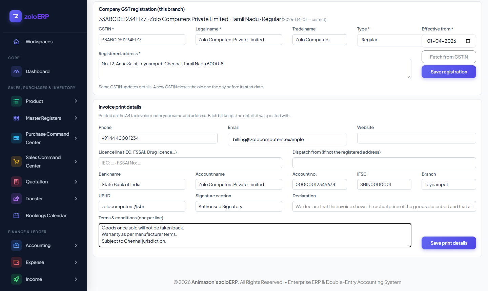

## Step 4: GST rate and HSN on the products

**Settings › GST › Products**, filtered to *All products* and searched by name:

| Product | Code | GST rate | HSN |
|---|---|---|---|
| AMD RYZEN 5 5600G | 1001 | GST 18% | 8542 |
| KINGSTON 8GB RAM | 1002 | GST 18% | 8473 |

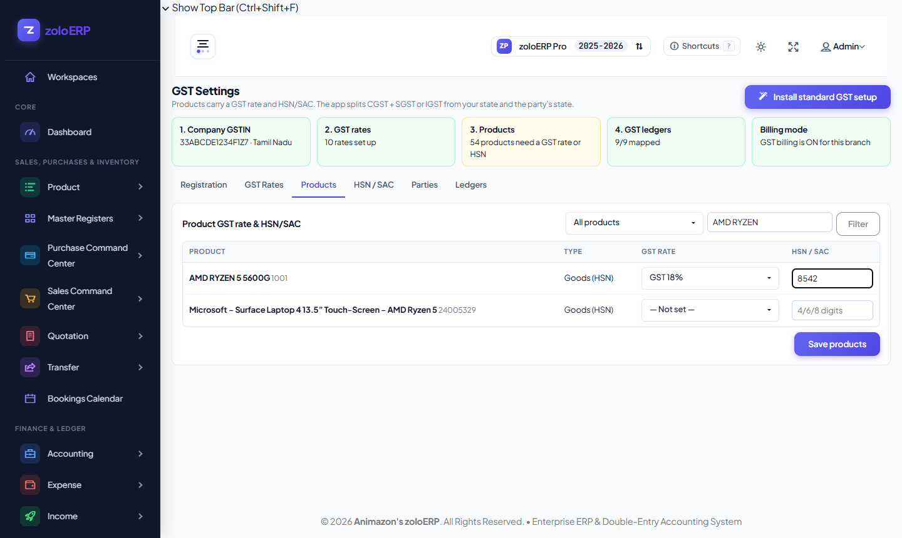

## Step 5: Customer GSTIN

**Customer › John Doe › Edit**: GSTIN `33PQRSX5678K1Z5`, state Tamil Nadu, PIN 600040.
The party's GST profile synced on its own (Settings › GST › Parties shows *Regular, Tamil Nadu*).
The customer is in the same state as the company, so the bill uses **CGST + SGST**, not IGST.

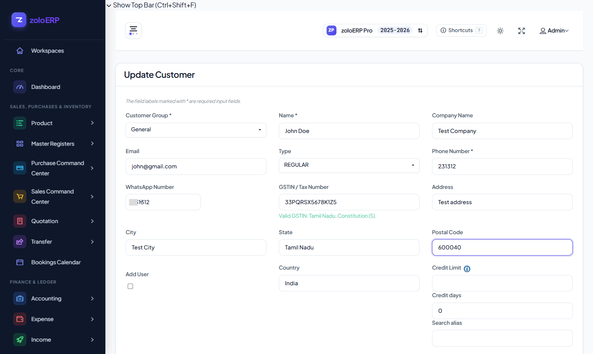
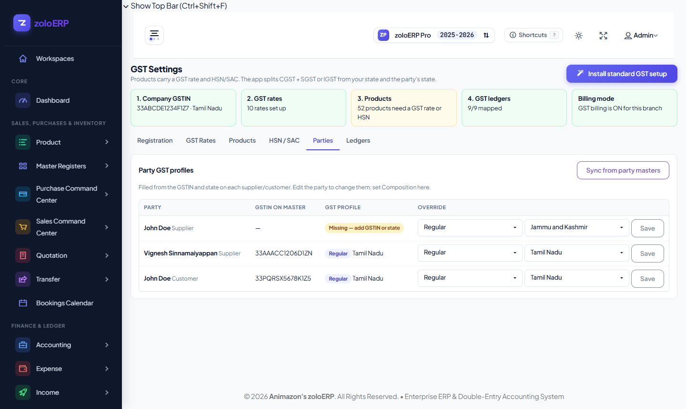

## Step 6: Enter the sales bill (F2)

1. From the dashboard, press **F2**. A new sales bill opens with focus on Party.
2. Party: open the picker, type `John`, press Enter. The details strip shows GSTIN `33PQRSX5678K1Z5` and the address.
3. In the item search row (Alt+I), type `1001` and press Enter, then set Qty to 2.
4. Type `1002` and press Enter, then set Qty to 4.
5. Click **Review**. The server returned *"Reviewed by server. Grand total: ₹ 15104.00"*.

| # | Item | Rate | Qty | Taxable | GST 18% | Total |
|---|---|---:|---:|---:|---:|---:|
| 1 | AMD RYZEN 5 5600G | 3,500.00 | 2 | 7,000.00 | 1,260.00 | 8,260.00 |
| 2 | KINGSTON 8GB RAM | 1,450.00 | 4 | 5,800.00 | 1,044.00 | 6,844.00 |
| | **Total** | | | **12,800.00** | **2,304.00** (CGST 1,152 + SGST 1,152) | **15,104.00** |

There is no round-off on this bill because the total is already a whole number of rupees.


## Step 7: First Save was refused because there was no stock

Clicking **Save** gave *"Insufficient stock for product 36 in warehouse 1: 0 available, 2 requested."*
The product's *negative stock allowed* flag does not override this check when posting.
The bill stayed open as a draft tab, so nothing was lost.

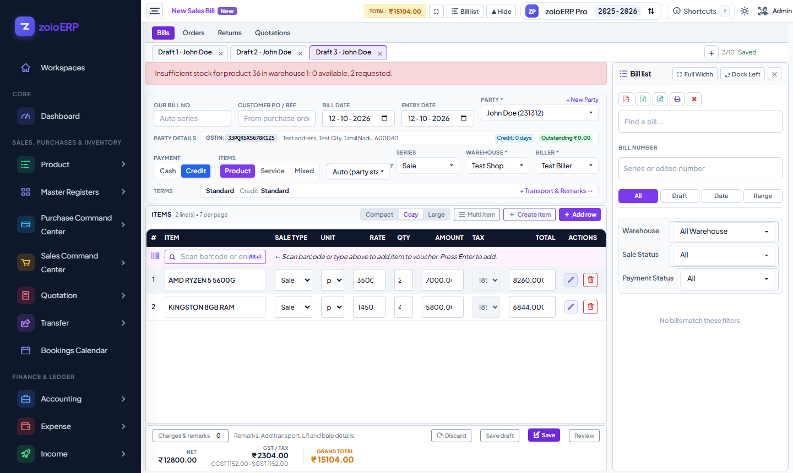

To fix it, I entered a purchase bill (**F12**) from supplier *John Doe (Test Company)* for 10 × AMD RYZEN 5 5600G at ₹2,500 and 10 × KINGSTON 8GB RAM at ₹1,000.
It posted as **PUR-00001** for ₹35,000 with no GST, because the supplier has no GSTIN. Stock is now 10 of each.

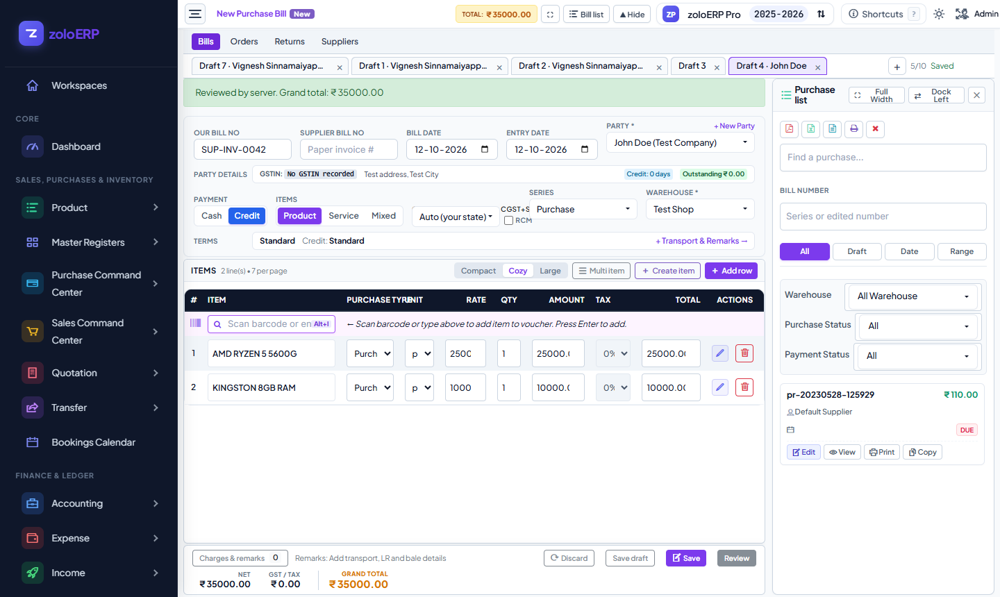

## Step 8: Second Save was refused because of a bug, now fixed

Back on **/sales**, I reopened the saved draft tab and clicked **Save**. It was refused with *"The reference must belong to the selected product."*

**Cause:** when a draft tab is reopened, `public/js/document-workspace.js` copies each saved row attribute back with `row.setAttribute(name, value)`.
A line with no batch has `data-batch-id: null`, and `setAttribute` stores that as the text `"null"`.
The form then sends `product_batch_id: "null"`, and `CompanyWriteGuard` rejects it as a batch that does not belong to the product.
This affects every sales or purchase draft that is reopened (after a reload or a tab switch) and has a line without a batch.

**Fix** (one line in `restoreLines()`): a `null` value now removes the attribute instead of setting it.

```js
Object.entries(line.data).forEach(([name, value]) => value === null ? row.removeAttribute(name) : row.setAttribute(name, value));
```

After the fix, the same draft posted.

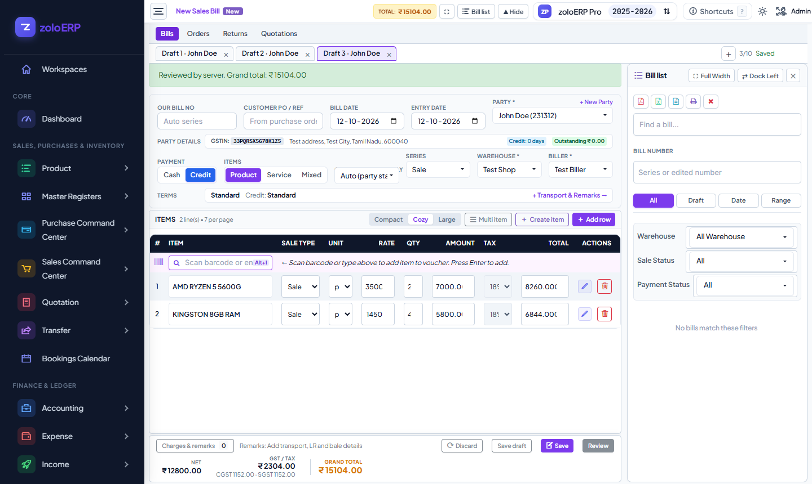

## Step 9: Posted, and what was recorded

Bill **MJ-00001** (sale id 56): Completed, payment Credit, status *Due*, grand total 15,104.00. The draft tab was removed when the bill posted.

Journal entry 106 (debits equal credits):

| Account | Debit | Credit |
|---|---:|---:|
| 1100 Accounts Receivable (Debtors) | 15,104.00 | |
| 4010 Sales Revenue | | 12,800.00 |
| 2050 Output CGST | | 1,152.00 |
| 2051 Output SGST | | 1,152.00 |
| 5010 Cost of Goods Sold - Products | 9,000.00 | |
| 1200 Merchandise Inventory Asset | | 9,000.00 |

Cost of goods sold is 2 × 2,500 + 4 × 1,000 = 9,000, using the purchase costs from step 7.

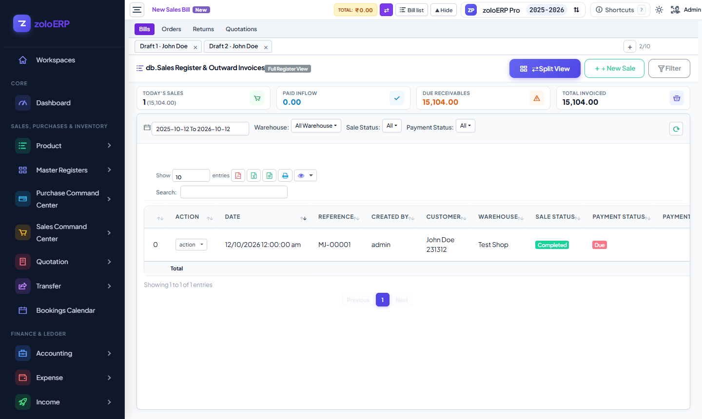

## Step 10: Print the tax invoice

On **/sales**, click **Split View** and find **MJ-00001** in the bill list on the right. Click **Print**.
A new tab opens `/compliance/documents/sale/56/print?format=a4`.
For a server-made PDF, add `&output=pdf` to that address (DomPDF). That is how [tax-invoice-MJ-00001.pdf](tax-invoice-MJ-00001.pdf) was saved.

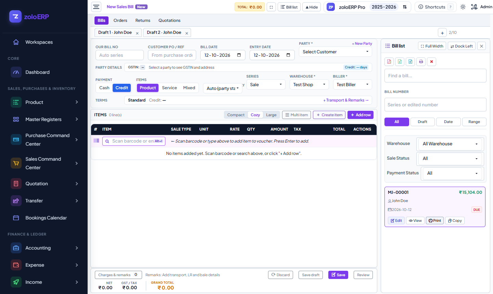
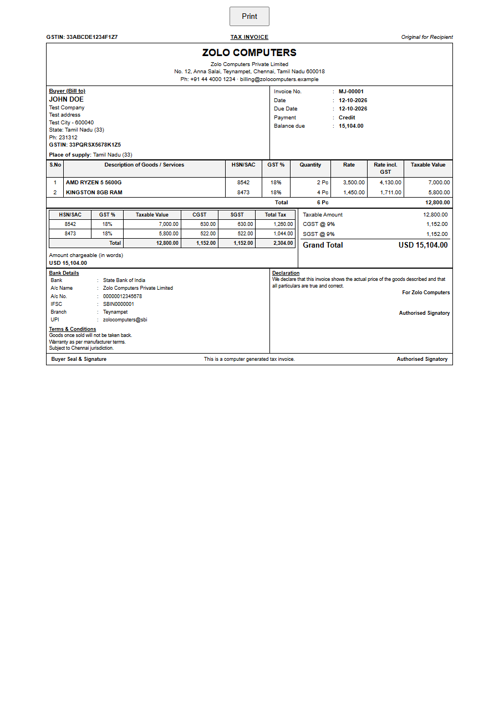

The invoice shows the seller GSTIN, the buyer's Bill-to block with GSTIN and state, place of supply Tamil Nadu (33), HSN and GST % per line, rate including GST, an HSN-wise CGST/SGST summary, bank details, terms, declaration and signatory.

---

## Step 11: Company profile, INR and logo (follow-up)

The first invoice showed the made-up GST name "Zolo Computers" and printed **USD**.
Company details now have one home, and the invoice reads them from there.

**What was built**
- **Settings › Company profile** (sidebar › Settings, admins only): display name, legal name, logo upload (PNG/JPG up to 1 MB), address, city, state, PIN, phone, email, website, GSTIN, PAN, GST type, base currency (with an option to also make it the app default) and industry/business type.
- **New company dialog** in the group/company picker (`/select-company?manage=1`) asks for the same details when a company is created inside a group or as an independent company.
- A GSTIN saved on the profile creates or updates the branch GST registration. The registration's legal name, display name and address then always match the company, so bills carry the company name.
- The A4 invoice prints the logo, the address, phone, email, website and PAN from the profile. Bank details and terms stay under **Settings › GST & Tax › Registration**.
- A migration adds the profile columns to `companies` and adds the **Indian Rupee (INR, ₹)** currency. New companies default to INR.

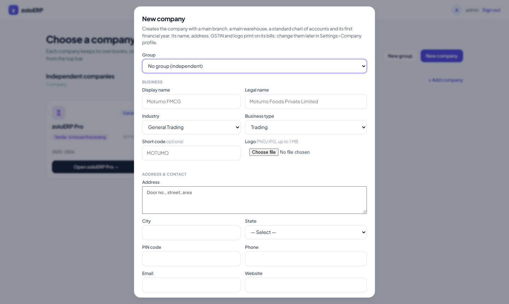
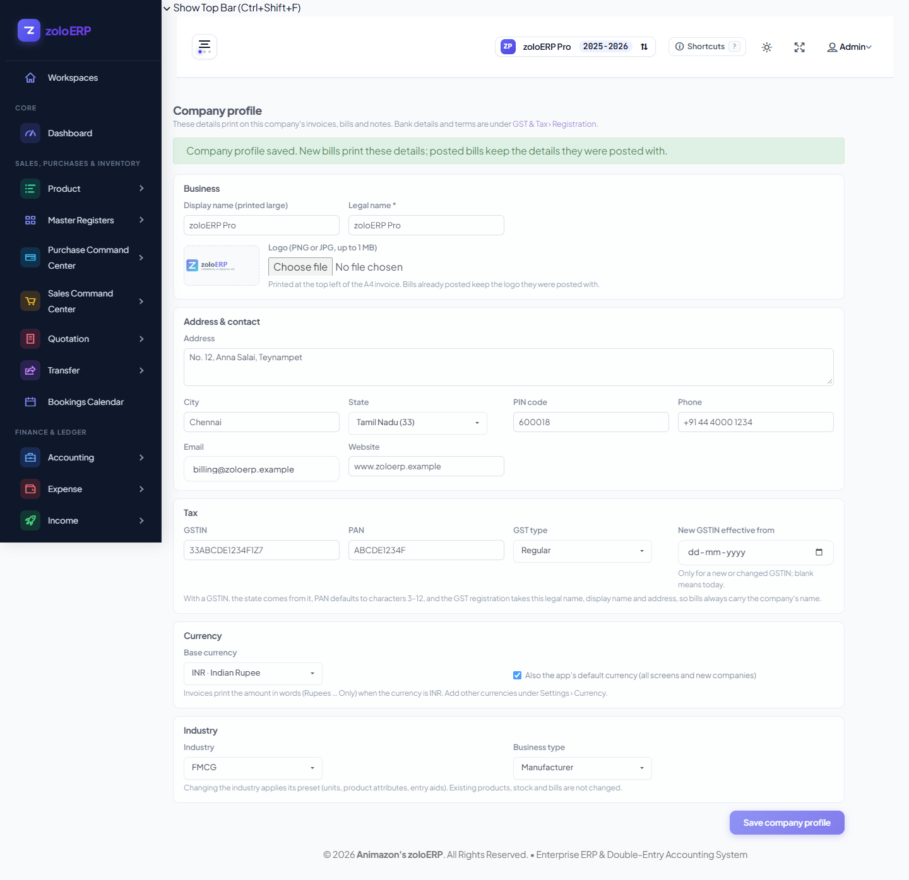

**Applied to company 1 through the profile page**
- Display/legal name kept as **zoloERP Pro**, with the sample address, contact and GSTIN `33ABCDE1234F1Z7`. The GST registration was renamed from "Zolo Computers Private Limited" to zoloERP Pro.
- Logo uploaded (`public/logo/zoloerp_logo.png`).
- Base currency **INR**, also set as the app default (`general_settings.currency`). USD stays as a foreign currency.
- Industry changed from Textile · In-house processing to **FMCG · Manufacturer**.
- Bank account name and UPI changed to zoloERP Pro / `zoloerp@sbi` on the GST page.

**Result:** bill **MJ-00002** (1 × RYZEN, 2 × RAM; taxable 6,400 + CGST 576 + SGST 576 = **₹7,552**) prints under **ZOLOERP PRO** with the logo, PAN and "Seven Thousand Five Hundred Fifty Two Rupees Only". See [tax-invoice-MJ-00002.pdf](tax-invoice-MJ-00002.pdf).

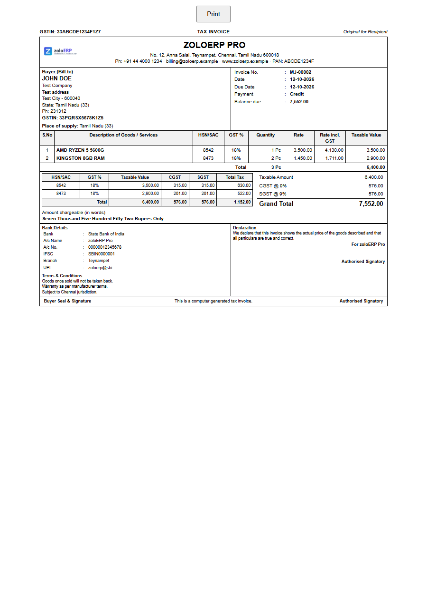

MJ-00001 still prints "Zolo Computers" and USD. That is on purpose: a posted bill keeps the details it was posted with. To correct it, reverse it and post it again.

---

## Issues found

| # | Issue | Status |
|---|---|---|
| 1 | A reopened draft sends `product_batch_id: "null"`, so the bill cannot post (step 8) | **Fixed** in `public/js/document-workspace.js`; not yet committed |
| 2 | The invoice prints **"USD 15,104.00"**, and the amount in words is just "USD 15,104.00". The company's base currency is USD, the only row in `currencies`. Amount in words (Indian lakh/crore wording) only prints when the currency is INR. | **Fixed** in step 11: INR added and set as the base currency. MJ-00001 keeps USD because it was already posted |
| 3 | The full register's row **action** menu has no Print item. Printing works only from the Split View bill list or the bill details. | Open |
| 4 | Company 1 has no way to install the standard chart of accounts from a screen; it needed tinker (step 1). New companies get it automatically. | Open |
| 5 | Posting checks stock even when the product allows negative stock (step 7). | Probably intended; please confirm |
| 6 | "Our Bill No" typed on the purchase (`SUP-INV-0042`) was not used. The bill got the series number `PUR-00001`. | Not investigated |
| 7 | The sales draft tab from my first trial run (draft id 19, "Draft 2 · John Doe") is still open. | Close it with its × button |

## Data added to the dev database

- 32 chart-of-accounts rows, plus links for 9 posting roles (company 1)
- Tax registration `33ABCDE1234F1Z7`; company country/state set to IN/33; `companies.settings_json.invoice_print`
- Products 36 and 37: GST 18%, HSN 8542/8473; HSN codes added
- Customer 1: GSTIN, state and PIN; party GST profile
- Purchase PUR-00001 (₹35,000, +10 stock of each item) and sales MJ-00001 (₹15,104) and MJ-00002 (₹7,552), each with its journal entry
- Step 11: company profile fields, logo file under `public/images/company/` (git-ignored), INR currency (id 2) as base and app default, industry FMCG · Manufacturer
