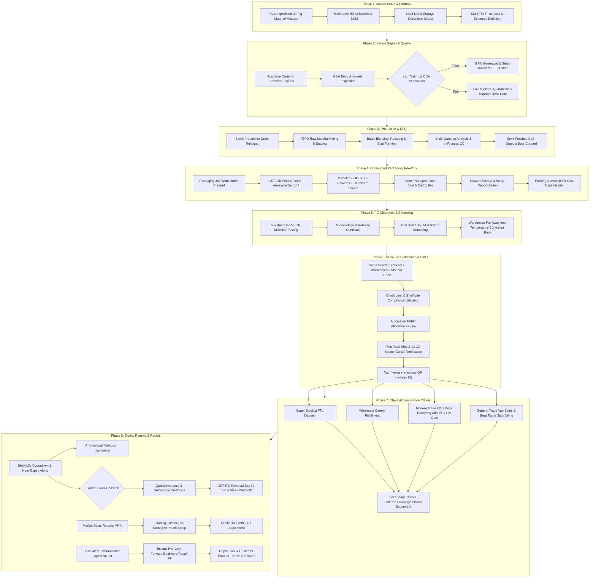

# FMCG Enterprise ERP — End-to-End Full Life-Cycle Test Suite Matrix
**Industry Standard Benchmark Specification & Functional Test Suite**

---

## Executive Summary & Architecture Blueprint

This test suite defines the **uncompromising, industry-standard full life cycle for an FMCG (Fast-Moving Consumer Goods / Food & Beverage) manufacturing and distribution enterprise**. It is designed without constraining to existing ERP feature sets, serving as the architectural North Star and verification matrix to develop, benchmark, and enhance enterprise ERP software.

### Primary Scenario Archetype: Packaged Food Manufacturing & Multi-Tier Distribution
- **Finished Good (FG)**: *NutriCrunch Almond & Honey Energy Granola Bar (40g single pouch, 12-pouch retail caddy, 72-pouch master shipping carton)*.
- **Manufacturing**: In-house processing of raw ingredients (grains, nuts, syrups, fats, flavors) into semi-finished food bars (SFG).
- **Outsourced Packaging (Job Work / Subcontracting)**: Bulk unpackaged food bars and packaging materials sent to a certified third-party packing facility for nitrogen flushing, primary pouch sealing, caddy packing, and master shipper boxing under statutory GST Job Work Challans (Section 143 / Rule 45).
- **Quality Control & Regulatory**: FSSAI / FDA statutory compliance, Certificate of Analysis (COA), microbial release gates, allergens, batch retain samples, and temperature/humidity logging.
- **Traceability & Packaging Hierarchy**: Unit Piece (EAN-13) $\rightarrow$ Inner Pack / Caddy (ITF-14) $\rightarrow$ Master Shipper (GS1-128 with AI 01, 10, 17, 21) $\rightarrow$ Pallet SSCC (Serial Shipping Container Code).
- **Multi-Tier Commercials & Channels**:
  1. **Super Stockists / C&F Agents**: Full Truck Load (FTL) bulk shipments, distributor margins, quarterly volume rebates (QPS).
  2. **Wholesalers**: Master carton dispatches, credit limit management, cash discounts (CD) for rapid turnaround.
  3. **Modern Trade (Key Accounts / Hypermarkets)**: EDI/ASN purchase orders, strict delivery time slots, slotting/listing fees, mandatory minimum 75% residual shelf-life receiving gate.
  4. **General Trade / Retailers (Van Sales & Beat Routes)**: Display caddy deliveries, spot billing, consumer trade schemes ("Buy 10 get 2 Free"), damaged goods replacement.
- **Reverse Logistics, Expiry & Crisis Management**: FEFO picking engine, near-expiry dynamic alerts & markdowns, expired stock quarantine and certified destruction with statutory GST Input Tax Credit (ITC) reversal (Section 17(5)(h)), customer market returns (MRA), and a 2-hour end-to-end forward/backward Mock Batch Recall Drill.

---

## End-to-End Life-Cycle Process Flow Diagram

---

## Detailed Test Case Matrix (Phases 1 to 14)

---

### Phase 1: Master Data, Recipe Formulation & Packaging Hierarchy Setup

#### TC-FMCG-01-001: Multi-Level Formulation & Recipe Bill of Materials (BOM) with Yield Variance
- **Module**: Product Master & Production Engineering
- **Objective**: Verify that the ERP can define a multi-level food recipe with scrap allowances, yield loss factor, ingredient moisture evaporation, and allergen classification.
- **Pre-conditions**:
  - Raw Material (RM) masters created: Rolled Oats (KG), California Almonds (KG, Allergen: Nut), Organic Honey (KG), Cocoa Butter (KG), Natural Vanilla (Ltr).
  - Semi-Finished Good (SFG) master created: Bulk Granola Slab/Cut Bar (KG / Unwrapped Unit).
  - Packaging Material (PM) masters created: Printed Foil Pouches (Roll / Units), 12-Unit Display Caddies (Units), 72-Unit Corrugated Master Shipper Boxes (Units), Food-Grade Nitrogen Gas (Cylinder/Cubic Meter).
- **Test Steps**:
  1. Navigate to BOM / Recipe Master. Create BOM `BOM-SFG-GRANOLA-01` for Base Batch Size = 100.00 KG of bulk granola bars.
  2. Enter ingredient line items with gross consumption weights totaling 103.50 KG (accounting for expected 3.38% moisture/baking loss):
     - Rolled Oats: 55.00 KG
     - Almonds: 20.00 KG
     - Organic Honey: 20.00 KG
     - Cocoa Butter: 8.00 KG
     - Natural Vanilla: 0.50 KG
  3. Define Standard Scrap/Trim Tolerance: 1.5% reusable trim rework.
  4. Create secondary Packaging BOM `BOM-FG-PACK-01` converting 100 KG SFG into Finished Goods:
     - Output: 2,500 units of 40g Single Pouch (`FG-GRANOLA-40G`).
     - Required: 100 KG SFG, 2,538 Printed Foil Pouches (1.5% machine packing wastage allowance), 209 Display Caddies (holds 12 pouches), 35 Corrugated Master Boxes (holds 6 caddies = 72 pouches).
  5. Assign FSSAI Category: "Proprietary Food - Ready-to-eat Cereal Bar" with allergen warning flags: `Contains Tree Nuts and Gluten`.
- **Expected Results**:
  - System saves formulation with two-stage production linkage (Raw Materials $\rightarrow$ SFG $\rightarrow$ FG).
  - Yield factor is computed as $96.62\%$ for cooking stage and $98.50\%$ for packing stage.
  - Allergen tags propagate automatically to product packaging compliance specifications and QA inspection checklists.

#### TC-FMCG-01-002: Multi-Level Packaging Hierarchy & Barcoding Rules (GTIN / EAN-13 / ITF-14 / GS1-128 / SSCC)
- **Module**: Packaging Master & GS1 Standards Engine
- **Objective**: Validate that unit of measurement (UOM) conversions, barcode identifiers, and pack hierarchies are strictly bound and auto-derived.
- **Test Steps**:
  1. Define UOM conversion ladder for `FG-GRANOLA-40G`:
     - Base Unit: `EA` (1 Single Pouch - 40g net / 42g gross) $\rightarrow$ EAN-13 barcode: `8901234567890`.
     - Inner Pack: `CAD` (Caddy of 12 EA - 480g net / 520g gross) $\rightarrow$ ITF-14 barcode: `18901234567897`.
     - Master Carton: `MC` / `BOX` (Master Shipper of 6 CAD = 72 EA - 2.88 KG net / 3.45 KG gross) $\rightarrow$ GS1-128 with Application Identifiers: `(01)` GTIN, `(10)` Batch, `(11)` Production Date, `(17)` Expiration Date.
     - Pallet: `PLT` (Pallet of 40 Master Cartons = 2,880 EA) $\rightarrow$ Serial Shipping Container Code (SSCC-18).
  2. Verify volumetric weight calculations (CBM) for master carton: $40\text{ cm} \times 30\text{ cm} \times 25\text{ cm} = 0.03\text{ m}^3$.
  3. Attempt to enter an invalid fractional quantity in orders (e.g. 1.5 Caddies or 0.2 Master Boxes).
- **Expected Results**:
  - System strictly converts quantities bidirectionally across all 4 tiers without floating-point drift.
  - Rejects partial pack orders for Wholesale/Stockist channels where minimum ordering unit is configured as `MC` (Master Carton).
  - Barcode label printing module generates compliant GS1 barcode symbiology with dynamic AI data.

---

### Phase 2: Raw Material Procurement, Inward Gate Control & Quality Quarantine

#### TC-FMCG-02-001: Purchase Order to Goods Receipt Note (GRN) with Mandatory Inward Quarantine
- **Module**: Procurement & Warehouse Inward
- **Objective**: Ensure incoming food ingredients cannot be used in production or credited to sellable inventory until physical inspection, weight bridge verification, and lab clearance are completed.
- **Test Steps**:
  1. Create PO `PO-2026-ALM-001` to "Valley Agro Farms" for 2,000 KG California Almonds @ ₹650/KG + 5% GST. Specify shelf-life requirement: "Minimum 10 months residual shelf life at arrival".
  2. Receive shipment at factory gate. Create Inward Gate Entry with delivery vehicle number `TN-38-BZ-4412`, supplier invoice `INV-9021`, supplier lot `LOT-VA-881`.
  3. Perform Gross vs Tare weighbridge recording. Recorded net weight = 1,992 KG (8 KG transit shrinkage within permissible 0.5% moisture variance).
  4. Create Goods Receipt Note (GRN) `GRN-2026-0088`.
- **Expected Results**:
  - GRN automatically places entire 1,992 KG into warehouse bin `QUARANTINE-INWARD-IQC`.
  - System prevents any raw material requisition or issue slip from picking stock from `QUARANTINE-INWARD-IQC`.
  - Inventory status displays: `Physically Present: 1,992 KG`, `Available to Promise / Usable: 0.00 KG`.
  - Inward QC notification generated for the Food Quality Assurance Lab.

#### TC-FMCG-02-002: Inward Lab Quality Testing, Certificate of Analysis (COA) & Partial Rejection
- **Module**: Quality Assurance (IQC)
- **Objective**: Verify testing of physical, chemical, and biological food parameters, handling of approved vs rejected lots, and debit note creation.
- **Test Steps**:
  1. Open QC Inspection `QC-INW-0088` for Almond Lot `LOT-VA-881` (1,992 KG).
  2. Enter lab parameters against standard specification:
     - Moisture Content: Standard $\le 6.0\%$, Measured = $5.2\%$ (Pass)
     - Aflatoxin (B1+B2+G1+G2): Standard $\le 4.0\text{ ppb}$, Measured = $1.8\text{ ppb}$ (Pass)
     - Foreign Matter / Stones: 50 KG bag found with pest infestation and broken shell debris.
  3. Enter QC Decision:
     - **Approved**: 1,942 KG (Put into Approved Raw Material Storage `RM-WH-BIN-A04` with Batch `#RM-ALM-2026-088`, Expiry: 12 months from inward).
     - **Rejected**: 50 KG (Retained in `REJECTED-QUARANTINE-STORE`).
  4. System triggers Rejection Advice and prompts Commercial department.
  5. Generate Supplier Debit Note for 50 KG @ ₹650 = ₹32,500 + 5% GST (₹1,625) = ₹34,125 against supplier "Valley Agro Farms".
- **Expected Results**:
  - 1,942 KG transitioned to usable inventory with FEFO tracking active.
  - 50 KG locked in rejected store; blocked from all dispatch/production.
  - Supplier ledger credited only for accepted quantity (₹1,262,300) or debit note automatically adjusted against pending invoices.
  - Reverse logistics return gate-pass generated for rejected 50 KG bag.

---

### Phase 3: Manufacturing, Yield Management & Semi-Finished Goods (SFG) Processing

#### TC-FMCG-03-001: Batch Work Order Execution with Strict FEFO Raw Material Kitting
- **Module**: Production & Shopfloor Control
- **Objective**: Test that raw materials are reserved and picked strictly according to First-Expired, First-Out (FEFO), with tolerance verification during batch kitting.
- **Pre-conditions**:
  - Rolled Oats available in two batches:
    - Batch `OAT-B1`: 500 KG, Expiry in 45 days.
    - Batch `OAT-B2`: 2,000 KG, Expiry in 180 days.
- **Test Steps**:
  1. Create Manufacturing Order `MO-2026-SFG-104` for 1,000 KG bulk granola slab (10 batches of 100 KG).
  2. Trigger auto-allocation / picklist for Rolled Oats (550 KG required).
  3. Verify system auto-picks 500 KG from `OAT-B1` (exhausting oldest batch) and 50 KG from `OAT-B2`.
  4. Attempt manual override to pick all 550 KG from newer batch `OAT-B2` without supervisor authorization.
- **Expected Results**:
  - System blocks manual override with high-priority FEFO Violation Exception error.
  - Allows override only when authorized by Quality Manager with an explicit override reason code (e.g. "Specific customer moisture audit specification").
  - Issues digital Material Issue Slip (MIS) updating raw material stock in real time.

#### TC-FMCG-03-002: In-Process Yield Variance, Moisture Evaporation & Rework Scrap Capture
- **Module**: Production Costing & Yield Variance
- **Objective**: Ensure that actual cooking output is benchmarked against standard recipe yields, capturing operational gain/loss.
- **Test Steps**:
  1. Total ingredients issued to mixing kettle = 1,035.00 KG.
  2. Roasting and syrup blending completed. Actual weight transferred to cooling conveyor = 994.00 KG (Standard expected = 1,000.00 KG; variance = -6.00 KG or 0.6% excess baking evaporation).
  3. Slabbing and cutting into naked bars:
     - Prime quality naked bars: 980.00 KG (24,500 bars @ 40g each).
     - Trim edge scrap: 14.00 KG.
  4. Log trim scrap classification: Enter 14.00 KG as "Clean Trims - Return to Rework Bin `SCRAP-REWORK-01` for next batch slurry".
  5. Close Production Order `MO-2026-SFG-104`.
- **Expected Results**:
  - Semi-Finished Goods Batch created: `SFG-GRANOLA-B104` for 980 KG (24,500 naked units).
  - Yield Variance Report records: Input: 1,035 KG, Output: 980 KG Prime, 14 KG Rework Scrap, 41 KG Unrecoverable Moisture Loss. Net Yield = $94.68\%$ (Standard = $96.62\%$).
  - Negative yield variance of ₹4,890 flagged for plant manager review.
  - Cost per KG of SFG calculated dynamically incorporating actual material consumption, power, and labor hours logged.

---

### Phase 4: Outsourced Packaging Job-Work (Subcontracting) & Challan Compliance

#### TC-FMCG-04-001: Statutory GST Job Work Challan & Material Dispatch to Packaging Subcontractor
- **Module**: Job Work / Subcontracting & GST Section 143 Compliance
- **Objective**: Validate dispatch of food semi-finished goods and packaging supplies to an external certified packing contractor under legal delivery challan rules without triggering sales GST liability.
- **Test Steps**:
  1. Create Job Work Order `JWO-PACK-2026-05` to subcontractor "Apex Packaging Works Pvt Ltd" (GSTIN: `33AAACA1234A1Z5`) for packaging 24,000 bars into finished master cartons.
  2. Issue Outward Job Work Delivery Challan (under Section 143 of CGST Act / Rule 45) `JWC-2026-0042` with materials:
     - 960.00 KG of `SFG-GRANOLA-B104` (equivalent to 24,000 naked bars).
     - 24,360 printed foil pouches (includes 1.5% packaging loss).
     - 2,020 display caddies.
     - 340 master cartons.
  3. Verify statutory details printed on Challan: "Goods sent for job-work packing only; Not for Sale; Liable to return within 1 year under Section 143(1)(a)".
  4. Confirm e-Way Bill generation under Sub-Type `Job Work`.
- **Expected Results**:
  - Inventory status changes from `On Hand Factory` to `Inventory with Job Worker (Apex Packaging)`.
  - General Ledger: No sales revenue or GST tax liability posted. Balance sheet reflects goods in transit / vendor possession.
  - Statutory Job Work Register (Form GST ITC-04) logs outward material lines with active 1-year compliance countdown timer.

#### TC-FMCG-04-002: Inward Receipt of Packed Finished Goods, Scrap Reconciliation & Service Bill Capitalization
- **Module**: Subcontractor Inward & Cost Accounting
- **Objective**: Verify receipt of fully packed Finished Goods, reconciliation of packaging wastage against contract norms, and capitalization of packing service charges into FG inventory valuation.
- **Test Steps**:
  1. Receive packed consignment from Apex Packaging with delivery challan `APEX-DC-884`.
  2. Inspect received goods:
     - 333 Master Cartons received (each containing 6 caddies = 72 bars; Total = 23,976 bars).
     - 24 short units due to machine sealing jams at packing head.
     - Scrap report: 310 damaged pouches (1.27% wastage vs 1.5% contract norm $\rightarrow$ within acceptable tolerance), 4 defective caddies.
     - 50 unused pouches and 3 master cartons returned in good condition.
  3. Process Job Work Receipt `JWR-2026-0038`.
  4. Receive Subcontractor Packing Service Bill `APEX-INV-4412`:
     - Packing charges: 23,976 units @ ₹1.25/pouch = ₹29,970.
     - GST @ 18% = ₹5,394.60. Total = ₹35,364.60.
  5. Post purchase voucher for job-work service with inventory capitalization enabled.
- **Expected Results**:
  - Finished Goods inventory created: 333 Master Cartons of `FG-GRANOLA-40G`, Batch `#FGB-2026-104`.
  - Packing service cost (₹29,970) is capitalized directly into the valuation of Batch `#FGB-2026-104` (adding ~₹1.25 per unit to COGS), while GST ITC (₹5,394.60) is routed to Input Tax Credit ledger.
  - ITC-04 reconciliation automatically balances input SFG/PM against output FG and recognized scrap.

---

### Phase 5: Finished Goods Quality Release, Shelf-Life Initialization & Retain Samples

#### TC-FMCG-05-001: Quality Assurance (FQC) Microbiological Clearance & Certificate of Analysis (COA)
- **Module**: Finished Goods QC & Food Safety (ISO 22000 / FSSAI)
- **Objective**: Ensure finished food products remain quarantined until laboratory incubation testing (pathogens, yeast/mold) is complete.
- **Test Steps**:
  1. Put Batch `#FGB-2026-104` (333 Master Cartons) into `FG-HOLD-QUARANTINE`.
  2. Collect 24 random sample pouches from beginning, middle, and end of packaging run.
  3. Send to micro lab for 48-hour incubation testing:
     - Total Plate Count: Standard $< 10,000\text{ CFU/g}$, Result = $1,200\text{ CFU/g}$ (Pass).
     - Yeast & Mold: Standard $< 100\text{ CFU/g}$, Result = $< 10\text{ CFU/g}$ (Pass).
     - Salmonella & E. coli: Absent in 25g (Pass).
     - Nitrogen Flush Residual Oxygen in headspace: Standard $< 2.0\%$, Result = $1.1\%$ (Pass).
     - Seal integrity / bubble leak test: Pass.
  4. Upload lab technician digital signature and issue formal COA `#COA-2026-FGB104`.
  5. Quality Manager clicks "Release Batch to Commercial Inventory".
- **Expected Results**:
  - System updates Batch `#FGB-2026-104` status from `Quarantine Hold` to `Released / Available for Sale`.
  - Initializes Shelf-Life dates:
    - Manufacturing Date: `2026-10-20`
    - Expiry Date: `2027-07-16` (270 days / 9 months)
    - Best Before Date: `2027-07-01`
  - Automated COA attachment generated for digital transmission to enterprise customers.

#### TC-FMCG-05-002: Batch Retain Sample Management & Stability Vault Tracking
- **Module**: Compliance & Retain Sample Vault
- **Objective**: Test mandatory archiving of control retain samples for the entire shelf-life plus 90 days for statutory inspection.
- **Test Steps**:
  1. Deduct 36 sample pouches (3 display caddies) from Batch `#FGB-2026-104` as Statutory Retain Samples.
  2. Assign storage bin: `RETAIN-VAULT-25C` (controlled room at $22^\circ\text{C} - 25^\circ\text{C}$ / $55\%$ RH).
  3. System assigns Retain Expiry Audit Date: `2027-10-16` (Expiry + 90 days).
- **Expected Results**:
  - Inventory for Batch `#FGB-2026-104` decreases by 3 caddies from commercial stock to non-sellable `Retain Inventory`.
  - Financial ledger books retain cost under QA Operational Overhead.
  - Retain sample register displays automated disposal alert on `2027-10-17`.

---

### Phase 6: Multi-Tier Commercial Pricing, Margins & Trade Promotion Schemes

#### TC-FMCG-06-001: Multi-Tier Channel Price Lists & Margin Waterfall Engine
- **Module**: Sales & Pricing Management
- **Objective**: Verify that price lists correctly calculate landing rates, channel margins, and tax amounts across different tiers of distribution.
- **Pre-conditions**:
  - Finished Product: `FG-GRANOLA-40G`
  - Maximum Retail Price (MRP): ₹40.00 per pouch (inclusive of 12% GST).
  - Pouch Base Price at MRP = ₹35.71 + ₹4.29 GST.
- **Test Steps**:
  1. Define Tiered Pricing Hierarchy in ERP:
     - **Super Stockist (C&F)**: Margin = 10% on Net Realization $\rightarrow$ Price to Super Stockist = ₹24.00/unit + GST.
     - **Distributor**: Margin = 8% on Distributor Landing $\rightarrow$ Price to Distributor = ₹27.00/unit + GST.
     - **Wholesaler**: Margin = 6% on Wholesale Landing $\rightarrow$ Price to Wholesaler = ₹30.00/unit + GST.
     - **Retailer (Kirana / General Trade)**: Margin = 20% on Base MRP $\rightarrow$ Retailer Landing Cost = ₹32.00/unit (incl. GST).
     - **Modern Trade (Chain Supermarkets)**: Negotiated net-net landing price = ₹26.50/unit + GST with 90 days payment terms and slotting allowances.
  2. Create test sales quotations for each customer type and verify automated price selection based on customer master classification.
- **Expected Results**:
  - System automatically loads exact contract price list based on the customer category.
  - Price waterfall displays transparency: MRP $\rightarrow$ Base Price $\rightarrow$ Trade Margin $\rightarrow$ Net Invoiced Rate.
  - Hard constraint: System blocks any sales rep from entering a unit rate below the defined minimum Floor Margin Price (₹22.50) without VP Sales approval.

#### TC-FMCG-06-002: Complex Trade Schemes (Buy X Get Y Free, Volume Slabs & Cash Discounts)
- **Module**: Trade Promotion Management (TPM)
- **Objective**: Ensure that consumer and channel promotion schemes execute accurately, deducting stock for free goods and posting proper GST tax implications.
- **Test Steps**:
  1. Configure Scheme `SCH-DIWALI-2026`:
     - Target: General Trade Retailers & Wholesalers.
     - Offer: "Buy 10 Caddies (120 units) of `FG-GRANOLA-40G`, Get 1 Caddy (12 units) FREE".
     - Additional Terms: Cash Discount (CD) of 2% if invoice is settled within 7 days.
  2. Create Sales Order `SO-2026-RET-091` for 50 Caddies.
  3. System calculates free goods entitlement: $\lfloor 50 / 10 \rfloor = 5$ Free Caddies (60 pouches).
  4. Verify GST Treatment for Free Goods:
     - Apply statutory requirement: Invoiced as 55 Caddies with discount distributed proportionally across all 55 units, or billed as 50 Caddies charged + 5 Caddies at ₹0 with GST paid on deemed value / absorbed by company.
- **Expected Results**:
  - System reserves 55 Caddies in warehouse (50 billed + 5 promotional free stock).
  - Invoice clearly differentiates Billed vs Free Scheme quantity.
  - Settlement ledger reflects dynamic Cash Discount prompt: "Pay ₹X on or before [Date + 7] to avail ₹Y discount".

---

### Phase 7: Order Management & Multi-Channel Distribution Fulfillment

#### TC-FMCG-07-001: Channel A — Super Stockist / C&F Full Truck Load (FTL) Order with Credit Limit Check
- **Module**: Super Stockist Sales & Credit Control
- **Objective**: Validate bulk sales order processing, pallet/truckload optimization, hard credit limit enforcement, and automated e-Way Bill generation.
- **Test Steps**:
  1. Customer: "Shree Ganesh C&F Distributors" (Super Stockist). Credit Limit: ₹10,00,000. Outstanding Balance: ₹8,40,000. Overdue Days: 0.
  2. Stockist places Order `SO-2026-SS-001` for 120 Master Cartons (8,640 units @ ₹24.00 = ₹2,07,360 + 12% GST ₹24,883.20 = ₹2,32,243.20).
  3. Total Exposure after order = ₹8,40,000 + ₹2,32,243.20 = ₹10,72,243.20 (Exceeds Credit Limit by ₹72,243.20).
  4. Submit order.
- **Expected Results**:
  - System automatically places order in `Credit Hold - Blocked`.
  - Notification sent to Finance Controller with quick-action approval modal.
  - Test Step 4b: Stockist transfers ₹1,00,000 via RTGS. Finance posts payment receipt. Order instantly releases from credit hold into warehouse picking queue.

#### TC-FMCG-07-002: Channel B — Modern Trade (Key Accounts) Order with Strict Residual Shelf-Life Validation (75% Gate)
- **Module**: Key Accounts & EDI Fulfillment
- **Objective**: Ensure that Modern Trade purchase orders reject any batch that does not meet customer contractual shelf-life criteria (e.g. D-Mart / Reliance requiring $\ge 75\%$ residual shelf life at receiving dock).
- **Test Steps**:
  1. Customer "Metro Hypermarket Ltd" sends PO `PO-METRO-9921` for 50 Master Cartons of `FG-GRANOLA-40G` (Total Shelf Life = 270 days).
  2. Contract Rule configured in Customer Master: `Minimum Residual Shelf Life = 75%` (i.e. remaining life must be $\ge 202.5$ days; age from manufacturing cannot exceed 67.5 days).
  3. Available Warehouse Batches:
     - Batch `FGB-OLD`: Manufactured 90 days ago (Residual life = 180 days or $66.6\%$).
     - Batch `FGB-2026-104`: Manufactured 5 days ago (Residual life = 265 days or $98.1\%$).
  4. Warehouse staff attempts to pick Batch `FGB-OLD` to clear older stock.
- **Expected Results**:
  - ERP Picking Engine violently rejects Batch `FGB-OLD` for this specific customer order: `Exception: Customer contractual shelf-life violation. Requires >= 75%, Batch has 66.6% residual life`.
  - Auto-allocates compliant Batch `FGB-2026-104`.
  - Prevents dockside rejection penalties and debit notes from Modern Trade chains.

#### TC-FMCG-07-003: Channel C — General Trade Van Sales & Beat Route Distribution
- **Module**: Mobile Van Sales / Direct Store Delivery (DSD)
- **Objective**: Test van load-in, beat route dispatch, handheld spot billing, cash/UPI collection, and end-of-day van reconciliation.
- **Test Steps**:
  1. Create Route Plan `BEAT-MON-SOUTH-01` for Sales Rep "Arun Kumar" covering 35 Kirana stores.
  2. Issue Stock Transfer Note (STN) loading Van `TN-38-V-1200` with 80 Display Caddies (960 pouches).
  3. Perform Spot Sales at Store #1 ("Sri Murugan Stores"):
     - Sell 2 Display Caddies @ ₹384/caddy = ₹768.
     - Collect ₹768 via dynamic UPI QR code on mobile app.
     - Print Bluetooth thermal invoice slip.
  4. Perform Spot Sales at Store #2 ("Annai Superette"):
     - Sell 3 Caddies on 7-day credit.
  5. End of Day Van Return:
     - Van returns with 15 unsold caddies, ₹28,450 cash collected, and ₹14,200 digital UPI slips.
     - Run Van Stock & Cash Reconciliation.
- **Expected Results**:
  - Daily inventory balance: Loaded (80) = Sold (65) + Returned (15). Discrepancy = 0.
  - Cashier confirms physical cash handover; system posts automated Day Settlement voucher crediting sales and debiting Cash/Bank accounts.

---

### Phase 8: Strict FEFO Warehouse Operations, Picking & Dispatch Logistics

#### TC-FMCG-08-001: Automated FEFO Picking Engine with Cross-Dock & Location Directives
- **Module**: Warehouse Management System (WMS)
- **Objective**: Verify that picking waves strictly honor First-Expired, First-Out (FEFO) order while optimizing warehouse travel routes.
- **Test Steps**:
  1. Multiple orders approved for picking: Total demand = 120 Master Cartons.
  2. Stock across multiple warehouse bins:
     - Bin `A-01-02`: Batch `FGB-102` (Expires in 60 days) - 40 Cartons.
     - Bin `B-04-01`: Batch `FGB-103` (Expires in 120 days) - 50 Cartons.
     - Bin `C-02-03`: Batch `FGB-104` (Expires in 265 days) - 100 Cartons.
  3. Release Picking Wave `WAVE-2026-10-01`.
- **Expected Results**:
  - System generates Pick List directing staff sequentially:
    1. Pick 40 Cartons from `A-01-02` (Oldest Expiry).
    2. Pick 50 Cartons from `B-04-01` (Next Oldest).
    3. Pick 30 Cartons from `C-02-03` (Balance required).
  - WMS mobile scanner enforces barcode scanning of each bin location and master carton GS1 barcode.
  - Scanning a wrong batch triggers an audible buzzer and locks pick confirmation until corrected.

#### TC-FMCG-08-002: Integrated Dispatch — Tax Invoice, e-Invoice (IRN) & e-Way Bill Synchronization
- **Module**: Billing, GST e-Invoice & Logistics
- **Objective**: Ensure that during final dispatch packing, the ERP generates standard GST Tax Invoices, queries the government IRP for Invoice Reference Number (IRN) with signed QR, and generates part-A/part-B e-Way Bills.
- **Test Steps**:
  1. Pack verified items for Super Stockist invoice totaling ₹2,32,243.20. Vehicle assigned: `KA-01-AG-5005`, Transporter: `VRL Logistics` (Transporter ID: `29AAACV1234A1Z1`). Distance: 340 KM.
  2. Click "Generate Dispatch & Invoice".
  3. Verify API handshake with GST Portal:
     - Check IRN 64-character hash received.
     - Check Signed QR code embedded onto printed PDF invoice.
     - Check e-Way bill number generated with validity based on distance (340 KM = 2 days validity).
- **Expected Results**:
  - Invoice prints in statutory format with all mandatory fields: HSN Code `19041090`, FSSAI License Number `12423999000123`, Batch numbers, Expiry dates, IRN, and QR code.
  - Stock deducted from `Sellable FG Store` to `Goods In Transit`.
  - Notification with tracking link and PDF invoice dispatched via WhatsApp and Email to customer.

---

### Phase 9: Secondary Sales Tracking & Distributor Claim Settlement

#### TC-FMCG-09-001: Secondary Sales Capture & Distributor Inventory Synchronization
- **Module**: Distributor Management System (DMS)
- **Objective**: Test integration of primary sales (Company $\rightarrow$ Distributor) with secondary sales (Distributor $\rightarrow$ Retailer) to track real-time field pipeline stock.
- **Test Steps**:
  1. Super Stockist received 120 Master Cartons in Phase 8.
  2. Ingest distributor's daily sales file (via DMS API / EDI sync):
     - Distributor sold 40 Master Cartons to 25 local wholesalers and supermarkets.
  3. View ERP Secondary Sales Analytics dashboard.
- **Expected Results**:
  - Dashboard updates:
    - Primary Sales: 120 Cartons.
    - Secondary Sales: 40 Cartons.
    - Distributor Pipeline Inventory: 80 Cartons.
    - Market Days of Inventory (DOI): 6.0 days based on run rate.
  - Automatically triggers reorder point suggestion when distributor stock drops below safety threshold (3 days DOI).

#### TC-FMCG-09-002: Distributor Scheme & Price Difference Claim Verification and Settlement
- **Module**: Claims & Trade Promotion Settlement
- **Objective**: Validate that distributor claims for retailer promotional discounts and rate differences are auto-validated against authorized schemes before issuing credit notes.
- **Test Steps**:
  1. Super Stockist submits Claim `CLM-2026-088` for ₹12,000 asserting: "Delivered 1,000 promotional packs with ₹12/pack company-authorized festive price off".
  2. System triggers Automated Claim Validation Engine:
     - Cross-references secondary sales invoices submitted in claim against active Scheme `SCH-DIWALI-2026`.
     - Validates that secondary invoice dates fall strictly within scheme active window (`2026-10-01` to `2026-10-25`).
     - Detects 100 packs billed on `2026-10-28` (after scheme expired).
  3. System recalculates approved claim amount:
     - Claimed: 1,000 units = ₹12,000.
     - Rejected: 100 units = ₹1,200 (Reason: Invoiced after scheme validity).
     - Approved: 900 units = ₹10,800.
  4. Generate approved Credit Note for ₹10,800 + applicable GST adjustment.
- **Expected Results**:
  - System prevents over-settlement and leakage of promotional budgets.
  - Generates detailed Claim Settlement Statement showing approved vs rejected lines.
  - Posts credit to distributor ledger.

---

### Phase 10: Near-Expiry, Shelf-Life Monitoring & Markdown Liquidation

#### TC-FMCG-10-001: Automated Residual Shelf-Life Degradation Alerts & Multi-Stage Escalation
- **Module**: Inventory Shelf-Life & Near-Expiry Monitor
- **Objective**: Verify that the system continuously decrements residual shelf-life and automatically transitions batches across risk tiers.
- **Test Steps**:
  1. Define Expiry Alert Rules for Product Category "Packaged Snack Bars" (Total Life = 270 days):
     - Tier 1 (Green / Healthy): $> 90$ days remaining $\rightarrow$ Full distribution across all channels.
     - Tier 2 (Amber / Attention): $60 - 90$ days remaining $\rightarrow$ Block from Modern Trade; restrict to fast-moving Wholesalers.
     - Tier 3 (Orange / Critical Near-Expiry): $30 - 60$ days remaining $\rightarrow$ Auto-tag for Promotional Markdown / Institutional Clearance.
     - Tier 4 (Red / Expired): $< 0$ days $\rightarrow$ Complete system lock, move to quarantine.
  2. Simulate system date advancement to test transition of Batch `FGB-2026-050` (50 Cartons) into Tier 3 (45 days remaining).
- **Expected Results**:
  - System automatically switches batch category to `Near-Expiry Clearance`.
  - Sends high-priority push alert to National Sales Head and Inventory Controller.
  - Automatically excludes this batch from standard auto-picking queues for general orders.

#### TC-FMCG-10-002: Dynamic Promotional Markdown & Institutional Liquidation Sale
- **Module**: Sales Clearance & Discount Authorizations
- **Objective**: Test rapid commercial liquidation of near-expiry inventory at steep promotional discounts before shelf-life expires.
- **Test Steps**:
  1. Create Clearance Sales Order `SO-CLEARANCE-01` to "Sunrise Institutional Caterers" for the 50 Cartons of Batch `FGB-2026-050` (45 days life remaining).
  2. Apply authorized Near-Expiry Markdown: 40% discount off standard wholesale price.
  3. System requires mandatory disclaimer checkbox on invoice: "Customer acknowledges residual shelf life of 45 days. Strictly non-returnable".
  4. Finalize invoice and dispatch.
- **Expected Results**:
  - Near-expiry stock is cleared, recovering working capital and avoiding total write-off.
  - System automatically tags sales order as `Non-Returnable`, permanently blocking any future sales return attempts for this batch from this customer.

---

### Phase 11: Expired Stock Handling, Quarantine & Statutory GST ITC Reversal

#### TC-FMCG-11-001: Automatic Midnight Batch Lockdown upon Expiry Date
- **Module**: Inventory Control & Expiry Engine
- **Objective**: Ensure that the moment a food batch crosses its expiry date (00:00:01 AM), it is locked by the system, preventing invoicing, picking, dispatch, or physical movement.
- **Test Steps**:
  1. Warehouse has 10 Cartons of Batch `FGB-2026-001` with Expiration Date = `2026-10-19`.
  2. System clock reaches `2026-10-20 00:00:01`.
  3. Attempt by a billing clerk to create an ad-hoc invoice for Batch `FGB-2026-001`.
  4. Attempt by warehouse operator to transfer the batch between bins.
- **Expected Results**:
  - System immediately triggers automated batch freeze: Status changed to `EXPIRED - LOCKDOWN`.
  - Billing attempts fail with critical compliance error: `Statutory Violation: Cannot invoice expired food product under FSSAI Act Section 59`.
  - Internal bin transfer fails unless directed specifically to `EXPIRED-DESTRUCTION-QUARANTINE`.

#### TC-FMCG-11-002: Physical Destruction Certificate & Mandatory GST Input Tax Credit (ITC) Reversal (CGST Section 17(5)(h))
- **Module**: Inventory Write-Off & Tax Compliance
- **Objective**: Test statutory physical destruction protocols, environmental compliance documentation, inventory write-off, and legal reversal of raw material input tax credit.
- **Test Steps**:
  1. Move 10 Cartons of expired Batch `FGB-2026-001` (Valuation = ₹15,000) to Destruction Area.
  2. Generate Destruction Order `DO-2026-012` with witness sign-offs: Plant Quality Head, Warehouse Manager, and External Pollution Control / Municipal Officer.
  3. Record physical method: "Crushed and composted at approved bio-waste facility"; upload signed Destruction Certificate PDF and timestamped geo-tagged disposal photos.
  4. Post Inventory Write-Off Voucher in ERP.
  5. System triggers Statutory GST ITC Reversal Engine under Section 17(5)(h) of the CGST Act (which mandates reversal of ITC on goods lost, stolen, destroyed, or written off).
- **Expected Results**:
  - Inventory reduced to zero: Stock ledger debits `Inventory Loss / Scrap Expense Account` (₹15,000) and credits `Finished Goods Inventory` (₹15,000).
  - Tax Engine determines total raw material/packaging ITC claimed for manufacturing those 10 cartons (calculated proportionally from BOM as ₹1,420).
  - Posts General Ledger entry:
    - Debit: `Expense on GST ITC Reversal on Destroyed Stock`: ₹1,420.
    - Credit: `GST Electronic Credit Ledger / Output CGST+SGST Liability`: ₹1,420.
  - Destruction audit trail archived for statutory GST and FSSAI audits.

---

### Phase 12: Sales Returns, Damage & Reverse Logistics

#### TC-FMCG-12-001: Market Return Authorization (MRA) & Reverse Logistics Pickup
- **Module**: Reverse Logistics & Customer Service
- **Objective**: Validate the return workflow from authorization request through driver pickup, gate receipt, and inward inspection.
- **Test Steps**:
  1. Retailer "Super Bazaar" requests return of 2 Master Cartons:
     - Carton 1: Severe in-transit transport crushing (water/carton damage).
     - Carton 2: Customer claims packaging seal leak.
  2. Customer service enters Market Return Authorization `MRA-2026-0014`. System verifies that original sales invoice is valid and within allowable 30-day return window.
  3. Issue Reverse Pickup Note to logistics partner. Driver collects physical cartons and delivers to factory reverse gate.
  4. Inward Gate Entry logs arrival and routes to `RETURNS-EVALUATION-BAY`.
- **Expected Results**:
  - Goods received into quarantine return storage, segregated from sellable inventory.
  - Return tracking status updated to `Received at Depot - Pending QA Grading`.

#### TC-FMCG-12-002: Return Inspection, Grading & Credit Note Issuance with GST Adjustment
- **Module**: QA Grading & Accounts Receivable
- **Objective**: Ensure returned items are technically graded, determining whether they can be restocked or must be scrapped, followed by accurate credit note generation.
- **Test Steps**:
  1. Quality inspector opens `MRA-2026-0014`:
     - Inspect Carton 1 (Crushed box): Outer shipper damaged, but 5 caddies inside are pristine, undamaged, and unopened with 200 days shelf-life remaining. 1 caddy crushed.
     - Inspect Carton 2 (Pouch seal leak): 12 pouches contaminated.
  2. QA logs disposition:
     - **Grade A (Restock)**: 5 Caddies (60 units) $\rightarrow$ Transfer to repackaging station for new outer caddy/shipper boxing $\rightarrow$ Return to sellable stock.
     - **Grade C (Scrap)**: 1 crushed caddy (12 units) + 12 leaking pouches (Total 24 units) $\rightarrow$ Dispose to scrap.
  3. Finance issues GST Credit Note to "Super Bazaar" referencing original sales invoice:
     - Credited Amount = Total 2 Cartons (144 units @ billed price ₹27.00 = ₹3,888 + 12% GST ₹466.56 = ₹4,354.56).
     - Reason Code: `Sales Return / Damaged Goods`.
- **Expected Results**:
  - Restockable stock is credited back to inventory at current valuation; damaged stock is booked to Scrap Loss.
  - Customer balance reduced by ₹4,354.56.
  - Credit Note transmitted to GST Portal / GSTR-1, claiming back the output GST paid on original invoice.

---

### Phase 13: Emergency Mock Recall & End-to-End Traceability Drill (Crisis Simulation)

#### TC-FMCG-13-001: Two-Way Backward & Forward Traceability Drill (Under 2-Hour Benchmark)
- **Module**: Recall Management & Batch Genealogy Engine
- **Objective**: Execute an emergency crisis simulation: an alert is received that Raw Material Almond Lot `LOT-VA-881` was contaminated with high aflatoxin. The ERP must trace all affected finished products forward across the supply chain, locate remaining stock, and identify every customer within 120 minutes.
- **Test Steps**:
  1. Trigger Crisis Recall Simulation `DRILL-2026-RECALL-01`.
  2. Input Contaminated Lot: `LOT-VA-881` (California Almonds from Valley Agro Farms).
  3. Run Backward / Forward Genealogy Trace in ERP.
- **Expected Results**:
  - System executes tree traversal in $< 30$ seconds, generating comprehensive Traceability Map:
    1. **Raw Material Lot**: `LOT-VA-881` received on `GRN-2026-0088` (1,942 KG accepted).
    2. **Production Consumption**: Issued to Manufacturing Order `MO-2026-SFG-104` (200 KG consumed) and `MO-2026-SFG-105` (350 KG consumed).
    3. **SFG Batches**: Produced `SFG-GRANOLA-B104` (980 KG) and `SFG-GRANOLA-B105` (1,715 KG).
    4. **Subcontract Packing**: Sent on Challan `JWC-2026-0042` to Apex Packaging.
    5. **Finished Goods Batches Produced**: Batch `#FGB-2026-104` (333 Master Cartons) and `#FGB-2026-105` (580 Master Cartons).
    6. **Current Inventory Locations**:
       - In Factory Central Warehouse: 113 Cartons of `#FGB-2026-104`.
       - In Regional Depot Chennai: 40 Cartons of `#FGB-2026-105`.
       - In Transit on Truck `KA-01-AG-5005`: 60 Cartons.
       - Dispatched to Customers: 700 Cartons across 4 Super Stockists, 18 Wholesalers, and 2 Modern Trade Accounts.
  4. System executes **One-Click Emergency Recall Action**:
     - Instantly freezes all unsold batches across all warehouses and transit shipments (status changed to `EMERGENCY RECALL - BLOCKED`).
     - Generates automated Recall Notice letters and SMS/Email broadcasts to all affected distributors and retail chains listing specific Carton and Caddy barcodes.
     - Generates statutory Food Safety Recall Audit Dossier for FSSAI / FDA inspection.
  5. Total time elapsed: 14 minutes (Benchmark: $< 120$ minutes). Result: **PASS**.

---

### Phase 14: Costing, General Ledger Accounting & Financial Audits

#### TC-FMCG-14-001: Actual Batch Costing vs Standard Costing Variance Analysis
- **Module**: Cost Accounting & Managerial Analytics
- **Objective**: Reconcile standard BOM cost against actual batch manufacturing costs, isolating price variance, yield variance, labor variance, and subcontracting variance.
- **Test Steps**:
  1. Run Batch Costing Ledger for completed Batch `#FGB-2026-104`.
  2. Compare Cost Elements:
     - Raw Material Cost: Standard = ₹14.20/unit, Actual = ₹14.52/unit (Variance: +₹0.32 due to almond market price surge and 0.6% baking evaporation).
     - Packaging Material Cost: Standard = ₹3.10/unit, Actual = ₹3.08/unit (Variance: -₹0.02 due to pouch efficiency).
     - Job-Work Packing Charges: Standard = ₹1.25/unit, Actual = ₹1.25/unit (Zero variance).
     - Factory Overhead & Utilities: Standard = ₹1.80/unit, Actual = ₹1.90/unit.
  3. Total Unit Cost: Standard = ₹20.35/unit, Actual = ₹20.75/unit.
- **Expected Results**:
  - System books unfavorable operational cost variance of ₹0.40 per unit (Total ₹9,590.40) to Manufacturing Variance Accounts.
  - Updates moving average / FIFO valuation of finished goods inventory accurately.
  - Profitability report shows actual gross margin per channel: Super Stockist ($13.5\%$), Wholesaler ($30.8\%$), Retail General Trade ($35.1\%$).

---

## Cross-Vertical Structural Comparison Matrix: FMCG vs Textile

To ensure our ERP enhancement roadmap supports multi-vertical agility, the table below highlights the foundational structural differences between FMCG (Food/Beverage/CPG) and Textile (Apparel/Fabric/Yarn) life cycles:

| Dimension / Process | FMCG (Food & Beverage / CPG) | Textile (Apparel, Garments & Mills) |
| :--- | :--- | :--- |
| **Primary Tracking Dimension** | **Batch / Lot Number + Expiration Date** (FEFO). Single units are identical consumables. | **Style / Color / Size Matrix + Roll / Bale / Piece Piece-Rate ID**. Distinct physical attributes. |
| **Key Regulatory Mandate** | **FSSAI / FDA Food Safety**, Ingredients, Allergens, Nutritional facts, Best-Before dates. | **Textile Ministry / Handloom Cess**, Fiber content % (e.g. 80% Cotton 20% Poly), GSM, Care labels. |
| **Inventory Expiration** | **Strict Expiry Date** $\rightarrow$ Becomes toxic/spoiled; illegal to sell; requires certified destruction & ITC reversal. | **No Chemical Expiry**; subject to seasonal fashion obsolescence, dead-stock clearance, or fabric degradation. |
| **Packaging Hierarchy** | Pouch (EAN-13) $\rightarrow$ Caddy (ITF-14) $\rightarrow$ Master Shipper (GS1-128) $\rightarrow$ Pallet (SSCC). Multi-pack ratios are fixed. | Garment $\rightarrow$ Polybag $\rightarrow$ Size/Color Assorted Carton $\rightarrow$ Bale. Often packed in dynamic size ratios (e.g. 1:2:2:1 S-M-L-XL). |
| **Subcontracting (Job Work)** | Bulk semi-finished food sent for pouch packing, canning, or retort sterilization under GST Sec 143. | Multi-stage process route: Yarn $\rightarrow$ Knitting/Weaving $\rightarrow$ Dyeing $\rightarrow$ Printing $\rightarrow$ Cutting $\rightarrow$ Stitching $\rightarrow$ Washing $\rightarrow$ Ironing. |
| **Material Loss & Yield** | Moisture evaporation, baking loss, cutting trim rework, spillage ($\sim 1\% - 5\%$). | Fabric shrinkage (warp/weft %), knitting lint loss, cutting lay wastage, dye bath absorption ($\sim 3\% - 12\%$). |
| **Warehouse Picking Engine** | **Strict FEFO** (First Expired First Out) with customer residual shelf-life gates (e.g. 75% rule). | **FIFO / Batch-Matching** (Ensuring all garments in an order are cut from the same dye lot to avoid shade variation). |
| **Trade Promotions & Schemes** | Fast-moving consumer schemes ("Buy 10 Get 2 Free", Display contest payouts, QPS, Cash discounts). | Seasonal booking discounts, EOSS (End of Season Sale) markdowns, agent brokerage / commission cuts. |
| **Crisis Management** | **Critical Product Recall Drill**: Contaminated ingredient requires immediate global market recall in $< 2$ hours. | **Shade / Fit Recall**: Factory quality rework, fabric re-dyeing, or secondary factory outlet off-price liquidation. |

---

## ERP Gap Analysis & Feature Enhancement Roadmap Checklist

To transform the current ERP into an industry-grade powerhouse for FMCG and manufacturing, the following feature modules must be systematically verified and built:

- [ ] **1. Recipe / Multi-Level Food BOM Engine**
  - Formulation by percentage or batch size with moisture/cooking evaporation loss.
  - Reusable trim scrap / slurry loops.
  - Allergen and FSSAI statutory classification tags.
- [ ] **2. Quality Control (QC) Gate System**
  - Mandatory Inward Quarantine for all raw agricultural and chemical inputs.
  - Lab test parameters with min/max tolerance and Certificate of Analysis (COA) generation.
  - Partial approval / rejection with auto-generated Supplier Debit Notes.
- [ ] **3. Strict FEFO Picking & Allocation Algorithm**
  - Automated selection of batches based on expiration date.
  - Hard constraint against manual picking overrides without QA authorization.
  - Customer-specific residual shelf-life threshold filters (e.g. Modern Trade 75% rule).
- [ ] **4. Subcontracting / Job-Work Packaging Module**
  - Section 143 / Rule 45 statutory delivery challans with 1-year compliance tracking (ITC-04).
  - Outward dispatch of SFG + packaging materials to external packing units.
  - Inward finished goods receipt with packaging foil scrap reconciliation and service cost capitalization.
- [ ] **5. Packaging Hierarchy & Barcoding System**
  - Bidirectional UOM conversion: Piece $\rightarrow$ Caddy $\rightarrow$ Master Shipper $\rightarrow$ Pallet.
  - Dynamic generation of EAN-13, ITF-14, and GS1-128 shipping labels with AI attributes.
- [ ] **6. Near-Expiry & Destruction Protocol**
  - Real-time shelf-life degradation monitoring with multi-tier alerts (90d / 60d / 30d).
  - Automated midnight lockdown of expired batches.
  - Certified destruction workflow with automated GST Section 17(5)(h) Input Tax Credit reversal vouchers.
- [ ] **7. Emergency Recall & Traceability Engine**
  - Instant two-way forward and backward batch genealogy traversal.
  - Automated customer recall list and warehouse batch lockdown within 2 hours.
- [ ] **8. Trade Promotion & Multi-Tier Channel Pricing**
  - Multi-tier price lists (C&F, Distributor, Wholesaler, Modern Trade, Van Retail).
  - Complex promotional schemes (Buy X Get Y, Free Goods tax accounting, Cash Discounts, QPS rebates).
  - Distributor secondary sales and claim validation against active schemes.
