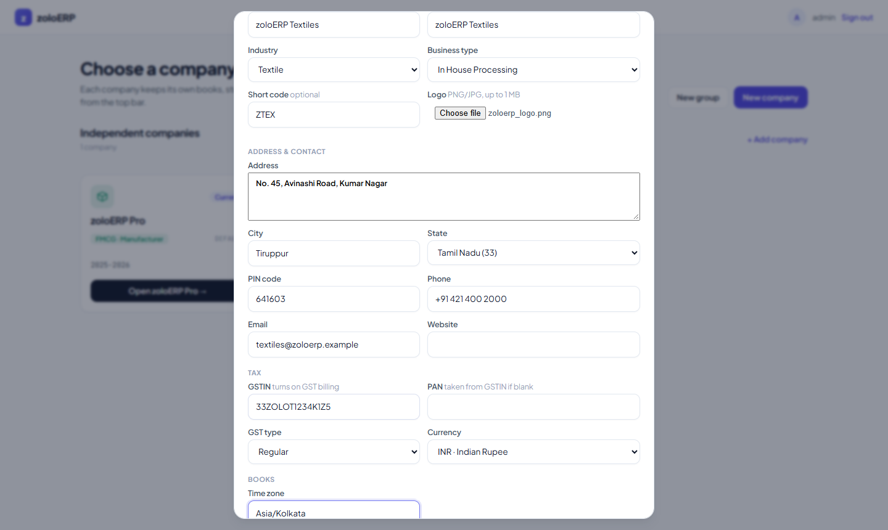
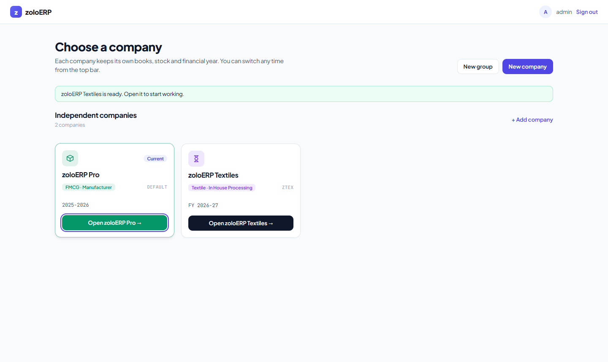
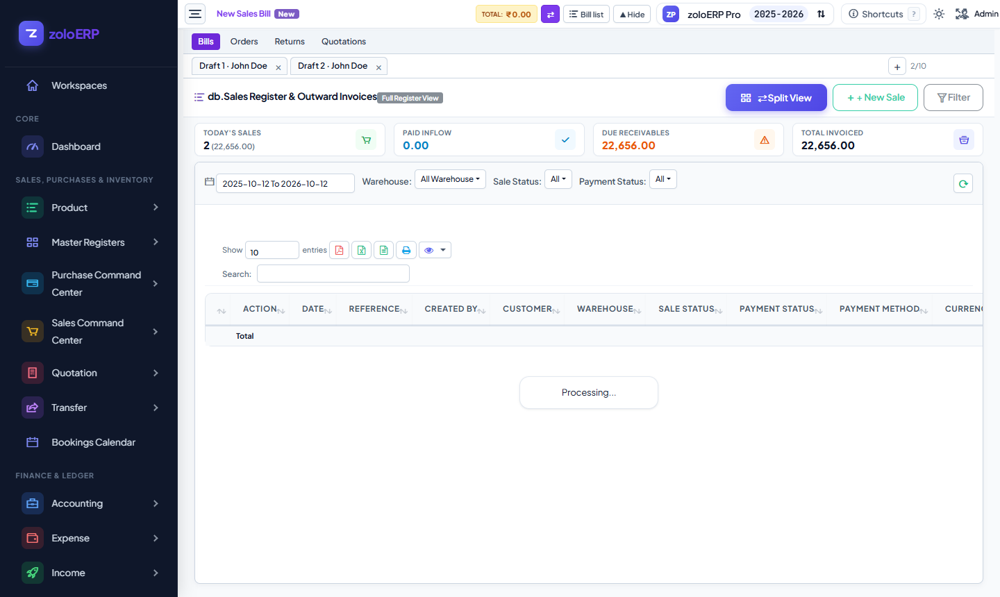
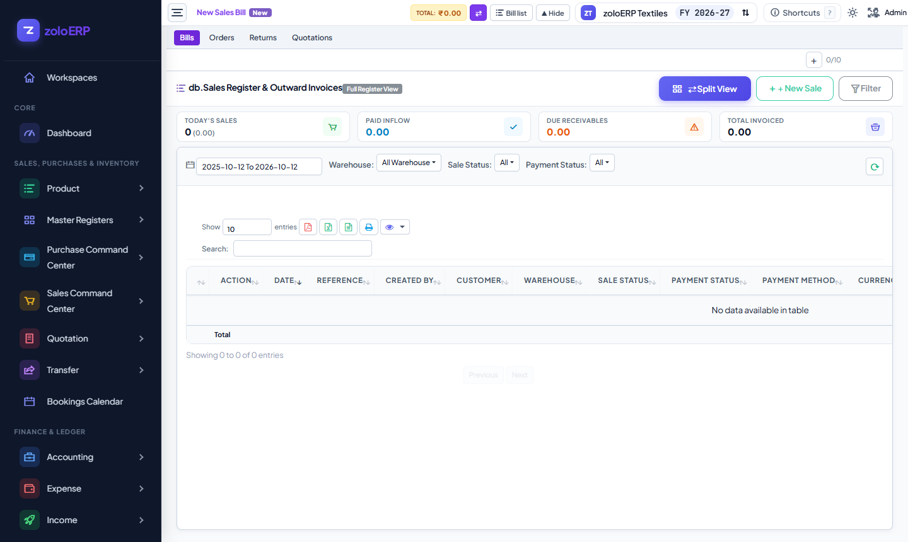
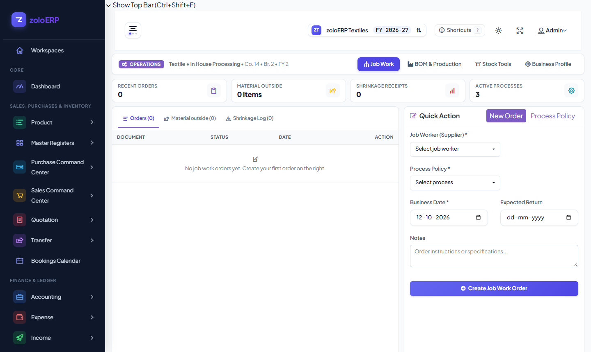

# Textile Company vs FMCG Company: What Changes

Done on 12-10-2026 in the dev app (`http://localhost:8080`).
A second company, **zoloERP Textiles**, was created through the company picker. The same screens were then opened in both companies and compared.
All GSTINs, addresses and contacts here are made up.

**Short answer:** Purchase, Sales, GRN and DC use **the same screens and the same posting logic** in every industry.
Choosing Textile switches on extra modules (Job Work, dot-matrix printing) and sets up some presets (product attributes, process types, decimal places).
It does not create separate textile versions of any document.

---

## 1. Creating the company

**Company picker › New company** (independent, not in a group):

| Field | Value |
|---|---|
| Display / legal name | zoloERP Textiles |
| Industry · business type | Textile · In-house processing |
| Short code | ZTEX |
| Logo | `public/logo/zoloerp_logo.png` |
| Address | No. 45, Avinashi Road, Kumar Nagar, Tiruppur, Tamil Nadu 641603 |
| Phone / email | +91 421 400 2000 · textiles@zoloerp.example |
| GSTIN | `33ZOLOT1234K1Z5` (PAN `ZOLOT1234K` taken from it) |
| Currency | INR |
| Time zone / financial year | Asia/Kolkata · 01-04-2026 to 31-03-2027 |

Created automatically:
- the Main branch
- the warehouse "zoloERP Textiles - Main"
- financial year 2026-27
- the standard chart of accounts (32 accounts, with their posting links)
- the GST registration under the company name, with the address from the form
- the textile industry preset

The first attempt failed with a `TypeError` on the logo upload. This was a bug in the previous push; see section 5.

---

## 2. What the industry choice changes

| Area | zoloERP Pro (FMCG · Manufacturer) | zoloERP Textiles (Textile · In-house processing) |
|---|---|---|
| Modules switched on (shared) | Sales, purchases, stock, accounting, GST, multiple units per item, wholesale, BOM + production, WhatsApp | Same |
| Modules switched on (only this one) | **Batch & expiry** (picks oldest-expiry stock first and blocks sales of expired batches) | **Job Work**, **dot-matrix printing** |
| Sidebar | — | Extra menu: **Subcontracting / Job Work** |
| Product attributes | MRP, shelf life (days), reorder level | Fabric type, construction, width, GSM, design, color, brand, roll/lot, rack/godown |
| Process types (for job work) | Outsourced repacking | Dyeing, Printing, Finishing (with an allowed loss % for shrinkage) |
| Quantity decimals on prints | 4 | 3 (meters) |
| Job work material dispatch print | — | Titled **"Material DC"**, dot-matrix 80 columns × 68 lines |
| Reports listed in the preset | Batch expiry, reorder, route distribution | Pending job work, job work shrinkage, stock by lot, previous rates |

---

## 3. Document by document

| Document | Changes for textile? | Details |
|---|---|---|
| **Purchase bill** (F12) | **No** | Same screen, numbering, GST and posting. |
| **Sales bill** (F2) | **No** | Same screen and same A4 tax invoice. Quantities print with 3 decimals. If transport / LR / bales / bundles are saved on a bill, they print in the invoice header (this works for any industry). |
| **GRN** (Alt+F12) | **No** | Same Goods Received Note screen. |
| **DC** (Alt+F2) | **No** | Same Delivery Challan screen. |
| **Job Work** | **Textile only** | New module. A job work order goes to a job worker (supplier) with a process (Dyeing / Printing / Finishing). Material sent out prints as a "Material DC"; material that comes back is received against the order, and shrinkage is checked against the process loss %. Shows *Material outside* and a *Shrinkage log*. In the FMCG company this page returns **403** (module off). |

Sales — identical in both companies:

| FMCG | Textile |
|---|---|
|  |  |

Purchase, DC and GRN are the same; see `*-purchases.png`, `*-dc.png` and `*-grn.png` in this folder.

Job Work — textile only:

Industry settings page (Operations › Business Profile): `fmcg-profiles.png` and `textile-profiles.png`.

---

## 4. Gaps found in the textile preset

| # | Gap | Effect |
|---|---|---|
| 1 | The preset lists unit **MTR**, but no unit is created. Units belong to each company, and the new textile company has **no units at all**. | A product can't be added until a unit (e.g. Meter) is created under Product › Unit. |
| 2 | Bale count, bundle count and LR fields are in the preset and print on the invoice, but there are **no input boxes** for them on the Sales/Purchase screens. Only the transporter name is in Transport & Remarks. | Bales/bundles can't be typed on a bill. |
| 3 | The "Job Work GRN" and "Godown" labels in the preset are **not used** anywhere. Only "Material DC" is used, on the job work dispatch print. | Screens still say GRN / Warehouse. |
| 4 | zoloERP Pro still has Dyeing / Printing / Finishing process types left over from when it was Textile. Switching industry adds the new presets but never removes old ones. | Harmless; they can be deactivated. |
| 5 | Sidebar items such as "Product Expiry Report" show in every industry (old menus that the modules don't control). | Some cleanup is possible. |

These fit the rule of one shared engine with presets: fixing 1–3 means filling the presets, not building textile screens.

---

## 5. Bug fixed while doing this

Saving **New company** with a logo crashed with `TypeError: Argument #3 ($logo) must be of type ?App\Services\Platform\IlluminateHttpUploadedFile`.
The type hint in `CompanyDirectoryService::createCompany` had lost its backslashes in the previous commit. It is now fixed.
A new test, `CompanyProfileTest::test_new_company_dialog_saves_profile_logo_and_gst_registration`, posts the New company form with a logo and GSTIN through the picker. 4/4 profile tests pass.
